# Mô tả hệ thống đã chốt

**HTTT hỗ trợ SME xác định nghĩa vụ tuân thủ — [TÊN SẢN PHẨM]**

Phiên bản 1.1 · 09/11/2026 (bản 1: 08/11/2026) · Bản nội bộ nhóm đồ án MIS
Đối tượng đọc: thành viên nhóm, giảng viên. Dùng làm nguồn cho Chương VIII, IX, XIII của báo cáo và clip trình bày ngày 09/11.

**Bản chuẩn duy nhất: `docs/mis/HE_THONG_DA_CHOT.md` trong repo (nhánh `mis/rebuild`).** Bản ở thư mục ngoài repo là bản 1, không cập nhật nữa. Thay đổi so với bản 1: xem "Nhật ký thay đổi thiết kế" cuối tài liệu.

---

## Mục lục

0. Cách đọc tài liệu
1. Bài toán, đầu vào, đầu ra, ranh giới
2. Phạm vi đã chốt
3. Sơ đồ khối kiến trúc
4. Lưu đồ tổng thể S1–S10
5. Input – Process – Output từng giai đoạn
6. Sơ đồ làn: ai làm bước nào
7. Sơ đồ luồng dữ liệu (DFD)
8. Quy tắc quyết định của S9
9. Bộ mã điều kiện C0–C7 và hồ sơ T0–T3
10. Ví dụ đối chiếu ba doanh nghiệp
11. Ba điểm chạy lại
12. Mô hình dữ liệu
13. Trạng thái MVP ngày 08/11
14. Việc cần làm đến code freeze 19/11
15. Thứ tự trình bày cho clip

Phụ lục A. Đối chiếu với sườn báo cáo · Phụ lục B. Thuật ngữ · Phụ lục C. Nguồn · Nhật ký thay đổi thiết kế

---

## 0. Cách đọc tài liệu

- §1–§12 mô tả **thiết kế đã chốt**. §13–§14 mô tả **trạng thái thật của MVP** và việc còn phải làm. Kế hoạch thi công chi tiết: `docs/mis/PLAN.md`.
- Nhãn trạng thái MVP: ✅ đã chạy · 🟡 có một phần · ❌ chưa có. Căn cứ: `UNDERSTANDING.md` (repo `main@9c62ff2`; truy vấn chỉ đọc trên Supabase production ngày 08/11/2026; `npm test` 43/43 pass) và `research/baseline/SUMMARY.md` (chụp lại ngày 09/11/2026).
- Màu trong sơ đồ §4: nền xanh lá = đã chạy; nền vàng = có một phần; khung nét đứt = chưa có.
- Đánh số S1–S10 trùng với `nexora-pipeline-cai-tien.html` và mục VIII.3 của sườn báo cáo. Sơ đồ tiếng Anh vẽ trong chat ngày 06/11 đánh số khác; không dùng sơ đồ đó.
- `CLAUDE.md`, `supabase/schema.sql`, `seed.sql`, `seed_customers.sql`, `docs/api-contract.md` trong repo mô tả mô hình dữ liệu cũ (cards / tasks), đã bị xóa từ migration `002_ner_graph.sql`. Khi viết báo cáo, dùng tài liệu này và `UNDERSTANDING.md`.
- Ví dụ điều luật ghi số điều, khoản. Ví dụ đánh dấu **†** được trích từ văn bản gốc chưa hợp nhất; phải đối chiếu bản hợp nhất trước khi đưa vào thư viện hoặc báo cáo (xem §2.3).

---

## 1. Bài toán, đầu vào, đầu ra, ranh giới

**Bài toán.** Doanh nghiệp không có bộ phận pháp chế cần biết: trong các quy định đang có hiệu lực, quy định nào áp dụng cho chính doanh nghiệp mình, hạn khi nào, phòng ban nào thực hiện, căn cứ ở điều khoản nào. Hệ thống trả lời câu hỏi đó cho từng doanh nghiệp từ hồ sơ dữ kiện khách quan, và ghi rõ chỗ nào chưa trả lời được và vì sao.

**Đầu vào**
1. Văn bản quy phạm pháp luật (bản hợp nhất).
2. Hồ sơ dữ kiện khách quan của một doanh nghiệp (T0–T3, §9.2).
3. Cấu hình phòng ban và người đầu mối của doanh nghiệp.

**Đầu ra**
Với mỗi cặp *doanh nghiệp × quy định trong thư viện*: một trong ba kết luận — **áp dụng**, **không áp dụng**, **cần bổ sung thông tin** — kèm điều khoản căn cứ, các trường hồ sơ và giá trị đã dùng, lý do (nếu cần bổ sung), phòng ban nhận việc, thời hạn (nếu văn bản quy định).

**Hệ thống làm**
1. Xác định quy định nào có điều kiện áp dụng thỏa với hồ sơ doanh nghiệp.
2. Chỉ ra điều kiện nào chưa xác định được và lý do.
3. Chuyển nghĩa vụ áp dụng tới phòng ban do doanh nghiệp tự cấu hình.
4. Lưu căn cứ của mọi kết luận; không sửa kết luận cũ.

**Hệ thống không làm**
1. Không tính số thuế phải nộp.
2. Không hướng dẫn cách thực hiện nghĩa vụ; không đề xuất phương án tối ưu thuế.
3. Không nộp hồ sơ thay doanh nghiệp.
4. Không tự xác định dữ kiện cần phán đoán pháp lý (ví dụ: doanh nghiệp có "quan hệ liên kết" hay không; ai là "chủ sở hữu hưởng lợi"). Những dữ kiện này không được hỏi trong hồ sơ. Quy định phụ thuộc vào chúng nhận kết luận "cần bổ sung thông tin", lý do "cần phán đoán chuyên môn".
5. Không tự phát hiện văn bản mới ban hành; chuyên viên nạp thủ công.

---

## 2. Phạm vi đã chốt

### 2.1 Văn bản

| Văn bản | Vai trò trong hệ | Trạng thái nạp |
|---|---|---|
| Luật Doanh nghiệp 59/2020/QH14, sửa đổi bởi 03/2022/QH15 và 76/2025/QH15 | Điều kiện theo loại hình doanh nghiệp; nghĩa vụ đăng ký, thông báo thay đổi có thời hạn | ❌ Chưa nạp |
| Luật Thuế TNDN 67/2025/QH15 và các luật sửa đổi (trong đó có 09/2026/QH16) | Quy định thuế có ngưỡng doanh thu, điều kiện loại trừ, điều kiện ưu đãi | ❌ Chưa nạp |
| Luật Quản lý thuế 108/2025/QH15 (hiệu lực 01/7/2026, thay Luật Quản lý thuế 38/2019/QH14) | Thủ tục khai, nộp, thời hạn. **Nạp toàn văn** (§2.2) | 🟡 9 chunk (Điều 2, 3, 8, 10, 11, 27, 48, 52, 53); 18 nghĩa vụ đã duyệt; 0 điều kiện máy đọc. Đề xuất cũ của 9 điều này được nạp lại ở `cho_duyet` để duyệt lại; các điều còn lại trích xuất mới |
| Nghị định 252/2026/NĐ-CP, Thông tư 90/2026/TT-BTC (hướng dẫn Luật 108) | Luật 108 giao nhiều nội dung cho hai văn bản này | ❓ **Câu hỏi mở: chưa quyết có nạp.** Không nạp → nghĩa vụ của Luật 108 dẫn chiếu sang đó mang mã C5 → "cần bổ sung", lý do `thu_vien_chua_du` |
| Thông tư 77/2025/TT-BTC | Rút khỏi thư viện đang chạy. Giữ làm dữ liệu "trước can thiệp" (đã chứng minh hệ loại đúng nghĩa vụ chứng khoán khỏi doanh nghiệp không kinh doanh chứng khoán). Không nạp sang CSDL mới | ✅ Đã nạp, 7 nghĩa vụ |

### 2.2 Tập quy định chọn để nạp

**Luật Quản lý thuế 108/2025/QH15: nạp toàn văn** (mọi điều qua S1–S3; trích xuất S5 và duyệt theo PLAN.md). Lý do: thủ tục khai, nộp có nhiều dẫn chiếu nội bộ giữa các điều; nạp rời từng điều làm S4 không nối được.

**Luật Doanh nghiệp và Luật Thuế TNDN: không nạp toàn văn.** Chọn 25–40 quy định từ hai luật này, mỗi quy định thỏa ít nhất một tiêu chí:
1. Có điều kiện theo loại hình, ngưỡng hoặc sự kiện, làm kết luận khác nhau giữa các doanh nghiệp.
2. Có liên kết với quy định ở văn bản khác: dẫn chiếu, loại trừ, thay thế.
3. Giao cho phòng ban khác với các quy định còn lại.

Quy định áp dụng cho mọi doanh nghiệp (C0) chỉ giữ vài mục làm đối chứng.

### 2.3 Văn bản nạp phải là bản hợp nhất

Hai file nhóm định nạp đều là **bản gốc**:

- **Luật Doanh nghiệp**: file là bản 59/2020/QH14 gốc. Luật 76/2025/QH15 (hiệu lực 01/7/2025) đã bổ sung khoản 5a Điều 8 và điểm h khoản 1 Điều 11 (thông tin chủ sở hữu hưởng lợi), bãi bỏ khoản 3, khoản 4 Điều 26, sửa khoản 1 Điều 31. File gốc vẫn còn khoản 3, 4 Điều 26 và không có nghĩa vụ về chủ sở hữu hưởng lợi. Chương V.3 của báo cáo lại dùng số liệu "42.911 doanh nghiệp chưa kê khai chủ sở hữu hưởng lợi".
- **Luật Thuế TNDN**: file là bản 67/2025/QH15 gốc. Luật này đã được sửa đổi bởi nhiều luật; Luật 09/2026/QH16 (thông qua 24/4/2026) bổ sung khoản 14a Điều 4: miễn thuế TNDN với doanh nghiệp có tổng doanh thu năm từ mức Chính phủ quy định trở xuống; quy định về ngưỡng doanh thu có hiệu lực từ 01/01/2026.

Nếu nạp bản gốc: thư viện chứa khoản đã bị bãi bỏ và thiếu quy định mới; S9 kết luận đúng theo thư viện nhưng sai theo luật đang có hiệu lực. Việc này thuộc S2. Trong MVP, S2 làm thủ công: dùng văn bản hợp nhất (ưu tiên bản hợp nhất chính thức), ghi lại khoản nào bị sửa, bởi văn bản nào, từ ngày nào.

### 2.4 Mốc thời gian (theo sườn báo cáo)

Nháp chữ 18/11 · **code freeze 19/11** · chạy Turnitin 20/11 · **nộp LMS 21/11**. Mốc "cuối tháng" dùng trong kế hoạch trước được thay bằng các mốc này.

---

## 3. Sơ đồ khối kiến trúc

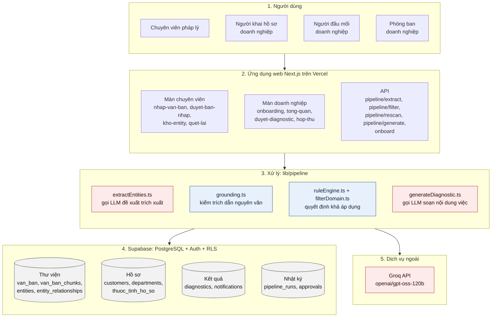

Màu: đỏ nhạt = thành phần gọi LLM; xanh nhạt = code tất định; xám = nhóm bảng dữ liệu. Mũi tên giữa các khối: khối trên gọi khối dưới. Thành phần nào đọc, ghi bảng nào xem DFD ở §7.

| Thành phần | Công nghệ | Việc làm | Gọi LLM |
|---|---|---|---|
| Ứng dụng web | Next.js 16 App Router, React 19, Tailwind 4, shadcn/ui; triển khai trên Vercel | Giao diện chuyên viên và doanh nghiệp; API | Không |
| Cơ sở dữ liệu | Supabase: PostgreSQL, Auth, Row-Level Security | Lưu toàn bộ dữ liệu. Ép ràng buộc duyệt bằng trigger, RLS, phân quyền theo cột | Không |
| Trích xuất | `extractEntities.ts`, schema Zod, prompt `extract-v4`, temperature 0 | Đề xuất entity và cạnh từ một chunk văn bản | Có |
| Kiểm trích dẫn | `grounding.ts` | Loại đề xuất có trích dẫn không tìm thấy nguyên văn trong đúng điều, trích dẫn dưới 12 ký tự, số điều ngoài chunk, cạnh sai chiều | Không |
| Quyết định | `ruleEngine.ts`, `filterDomain.ts` | Giai đoạn S9 | Không. CSDL ép `pipeline_runs.model IS NULL` với lượt chạy `filter_domain` |
| Soạn nội dung việc | `generateDiagnostic.ts` | Viết nội dung việc cần làm **sau khi** đã có kết luận; người đầu mối duyệt trước khi giao | Có |
| Lịch chạy | Vercel cron `/api/keep-alive` lúc 01:00 | Giữ Supabase không tạm dừng | Không |

---

## 4. Lưu đồ tổng thể S1–S10

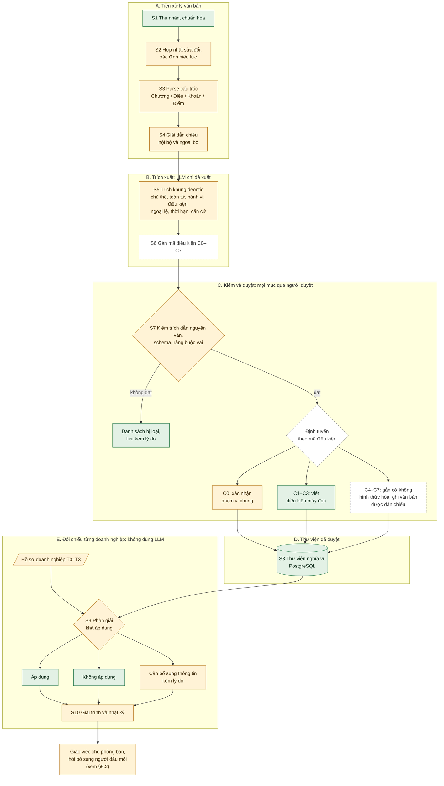

**Bốn điểm của lưu đồ**

1. LLM chỉ xuất hiện ở cụm B (đề xuất trích xuất) và ở bước soạn nội dung việc sau S10. S9 không gọi LLM.
2. Không mục nào vào S8 khi chưa có người duyệt. Ràng buộc này ép ở CSDL: trigger `guard_trang_thai_duyet` chỉ cho đổi trạng thái duyệt khi cờ phiên do `approve_entity`, `approve_chunk`, `approve_diagnostic` bật; các hàm duyệt yêu cầu `auth.uid()` là người thật có vai trò chuyên viên; RLS và phân quyền theo cột chặn ghi trực tiếp.
3. **Định tuyến theo mã điều kiện quyết định loại thao tác duyệt, không cho mục nào bỏ qua bước duyệt.** Đây là điểm sửa so với `nexora-pipeline-cai-tien.html` (bản đó cho C0–C2 vào thẳng S8). Lý do sửa: (a) trái với ràng buộc ở điểm 2; (b) nếu LLM gán nhầm một điều kiện C6 thành C0 và mục đó vào thẳng thư viện, nghĩa vụ trở thành "áp dụng cho mọi doanh nghiệp" mà không ai kiểm — đúng lỗi tất định câm đang có trong MVP (§13.2).
4. Hồ sơ doanh nghiệp chỉ gặp thư viện tại S9. Cụm E chạy riêng cho từng doanh nghiệp.

---

## 5. Input – Process – Output từng giai đoạn

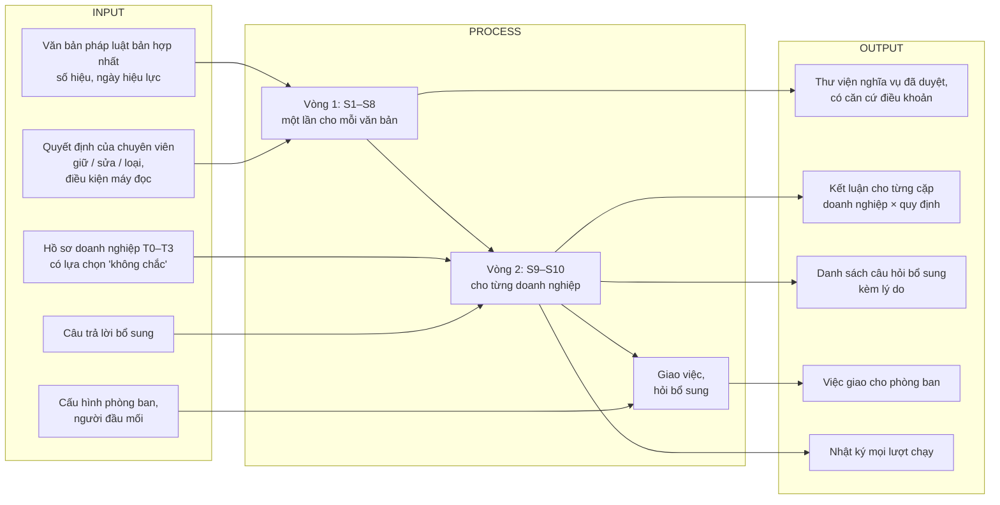

| Giai đoạn | Input | Xử lý | Output | Thực hiện | MVP 08/11 |
|---|---|---|---|---|---|
| S1 Thu nhận | File .txt/.md; số hiệu, ngày ban hành, ngày hiệu lực | Đọc phần đầu văn bản lấy số hiệu, tên, loại; chuẩn hóa ký tự | Bản ghi `van_ban` ở trạng thái `draft` | Code (`van-ban-parse.ts`) + chuyên viên | ✅ |
| S2 Hợp nhất, hiệu lực | Văn bản gốc + văn bản sửa đổi | Hợp nhất; xác định ngày hiệu lực, ngày hết hiệu lực từng khoản; ghi quan hệ thay thế | Văn bản hợp nhất; `van_ban.ngay_hieu_luc`; `van_ban_thay_the`; ngày hết hiệu lực (đề xuất) | Chuyên viên (thủ công) | 🟡 Có ngày hiệu lực và bảng thay thế. Chưa có ngày hết hiệu lực. S9 không đọc bảng thay thế. Hai file định nạp chưa hợp nhất |
| S3 Parse cấu trúc | Văn bản hợp nhất | Tách theo Chương / Điều / Khoản / Điểm, giữ quan hệ cha–con | Chunk có định danh | Code (`parse-van-ban.ts`) | 🟡 Tách theo tiêu đề "Điều N.", gộp điều dưới 100 ký tự, trần 6.000 ký tự. Không lưu Chương, Khoản, Điểm thành cột |
| S4 Giải dẫn chiếu | Chunk + cụm dẫn chiếu ("khoản 2 Điều này", "theo quy định của Chính phủ") | Chuẩn hóa thành định danh tuyệt đối; đi theo chuỗi bằng truy vấn đệ quy; phân loại dẫn chiếu treo | Cạnh `tham_chieu` có đích; danh sách dẫn chiếu treo hai loại | Code + chuyên viên | 🟡 Lưu cạnh `tham_chieu`; đích null kèm `target_ref_text`. Chưa giải, chưa phân loại |
| S5 Trích khung deontic | Chunk | LLM đề xuất entity (9 loại) và cạnh (6 loại) theo schema | Bản đề xuất trạng thái `cho_duyet` | LLM Groq | 🟡 Có chủ thể, hành vi, điều kiện, ngưỡng, thời hạn, chế tài, căn cứ. Chưa có toán tử deontic tường minh, chưa có hai loại ngoại lệ |
| S6 Gán mã C0–C7 | Điều kiện trong bản đề xuất | Gán mã; với C1–C3 viết điều kiện máy đọc `{thuoc_tinh, toan_tu, gia_tri}` | Mã điều kiện; điều kiện máy đọc | MVP: chuyên viên. Về sau: LLM đề xuất, người duyệt | ❌ Chưa lưu mã. Điều kiện máy đọc do chuyên viên viết tay (5 cái trên DB) |
| S7 Kiểm và duyệt | Bản đề xuất | Kiểm trích dẫn nguyên văn; kiểm schema; kiểm ràng buộc vai; định tuyến; người duyệt | Entity `da_duyet` / `tu_choi`; danh sách bị loại kèm lý do | Code (`grounding.ts`) + chuyên viên | 🟡 Trích dẫn ✅, schema ✅, duyệt ✅ (ép ở DB). Ràng buộc vai một phần (CHECK theo loại entity). Định tuyến ❌ |
| S8 Thư viện | Entity đã duyệt của văn bản `active` | Lưu; khóa nội dung đã duyệt | Thư viện nghĩa vụ | PostgreSQL | ✅ 25 nghĩa vụ |
| Hồ sơ T0–T3 | Câu hỏi sinh từ `thuoc_tinh_ho_so`, chỉ những trường có quy định C1–C3 đã duyệt dùng tới | Phần 1 hỏi khi đăng ký; phần 2 chỉ hỏi qua "hỏi bổ sung" khi S9 cần (§9.2). "Không chắc" / "Không muốn trả lời" → null, lưu riêng lý do | `customers.thuoc_tinh`, `departments` | Người khai hồ sơ; người đầu mối (phần 2) | 🟡 Thu 18 thuộc tính + 5 trường cố định, S9 dùng 2. Có một thuộc tính thuộc T4 |
| S9 Phân giải khả áp dụng | Nghĩa vụ + điều kiện + hồ sơ + ngày đánh giá | Quy tắc §8 | Kết luận, lý do, trường thiếu | Code (`ruleEngine.ts`, `filterDomain.ts`) | 🟡 Tất định ✅. Lỗi: không điều kiện = áp dụng; "cần bổ sung" bị rơi khi không có phòng ban khớp; chưa xét ngoại lệ, ngày hết hiệu lực |
| S10 Giải trình, nhật ký | Kết luận + đầu vào đã dùng | Ghi bản ghi mới; không sửa bản ghi cũ | `pipeline_runs` (input/output), `diagnostics.filter_run_id`, `approvals` | Code | 🟡 Có log mỗi lượt chạy. Chưa có định danh phiên bản thư viện riêng |
| Giao việc, hỏi bổ sung | `diagnostics` áp dụng / cần bổ sung | LLM soạn nội dung việc; định tuyến theo phòng ban; người đầu mối duyệt; thông báo; trả lời bổ sung → chạy lại 1 nghĩa vụ | Việc đã giao; câu trả lời bổ sung | `generateDiagnostic.ts`, `approve_diagnostic`, `notifications`, `hop-thu` | 🟡 Có. Luồng hỏi bổ sung chưa từng chạy với dữ liệu thật |

---

## 6. Sơ đồ làn: ai làm bước nào

### 6.1 Vòng 1 — xây thư viện (một lần cho mỗi văn bản)

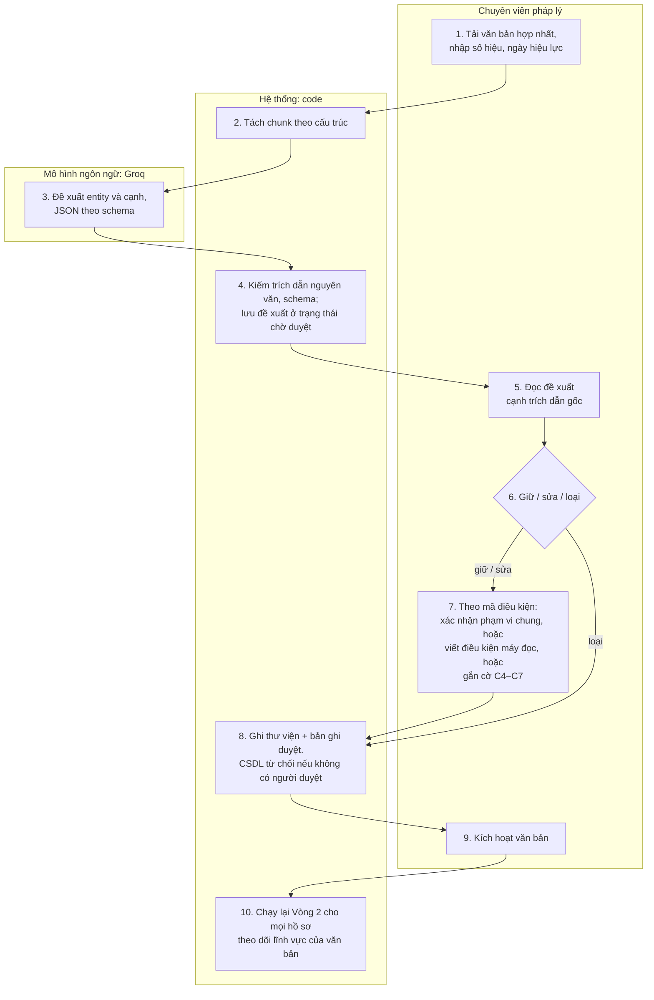

Hiện trạng MVP: bước 10 là nút "Quét lại khách hàng hiện có" bấm tay. Bước 9 đổi trạng thái văn bản trực tiếp, không qua hàm duyệt và không ghi `approvals` (§13.3).

### 6.2 Vòng 2 — đối chiếu và giao việc (cho từng doanh nghiệp)

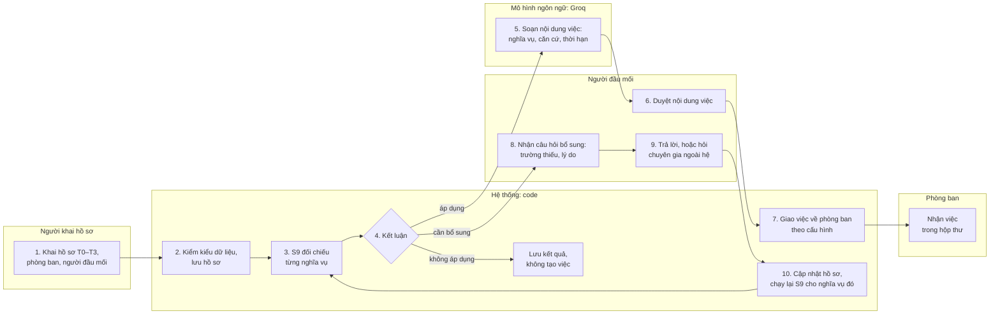

Quy tắc đã chốt cho Vòng 2:
- Kết luận "cần bổ sung" luôn tạo bản ghi và gửi người đầu mối, không phụ thuộc phòng ban (sửa lỗi `filterDomain.ts:286-292`).
- Bước 5: LLM chỉ được nêu nghĩa vụ, điều khoản căn cứ, thời hạn, phòng ban nhận. Không hướng dẫn cách làm, không đề xuất phương án. Người đầu mối duyệt trước khi giao. Đây là bước có rủi ro vượt ranh giới tư vấn cao nhất trong hệ.
- Phòng ban nhận việc lấy từ cấu hình của doanh nghiệp. Chuyên viên chỉ gán phòng ban gợi ý cho mỗi nghĩa vụ (`primary_departments`, có thể nhiều mã). Doanh nghiệp không có phòng ban khớp → giao Ban giám đốc. Không có cả Ban giám đốc → tạo dòng **chưa gắn phòng ban**; người đầu mối chọn phòng khi duyệt (`approve_diagnostic` không cho duyệt dòng chưa có phòng).
- Thời hạn: P0 hiển thị **nguyên văn thời hạn trong luật** kèm **ngày sự kiện** doanh nghiệp đã khai (ví dụ "trong thời hạn 10 ngày kể từ ngày có thay đổi · ngày thay đổi: 05/11/2026"). Hệ không tự tính ngày hạn trong P0 (tính hạn cụ thể: P1).

---

## 7. Sơ đồ luồng dữ liệu (DFD)

### 7.1 Mức 0 — sơ đồ ngữ cảnh

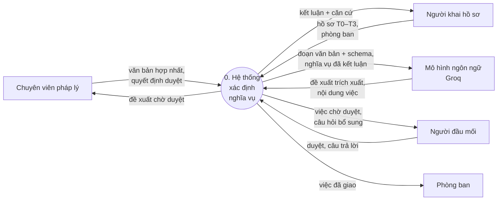

### 7.2 Mức 1, phần Vòng 1: tiến trình 1–3

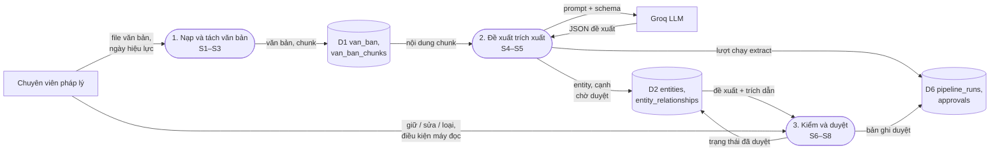

### 7.3 Mức 1, phần Vòng 2: tiến trình 4–6

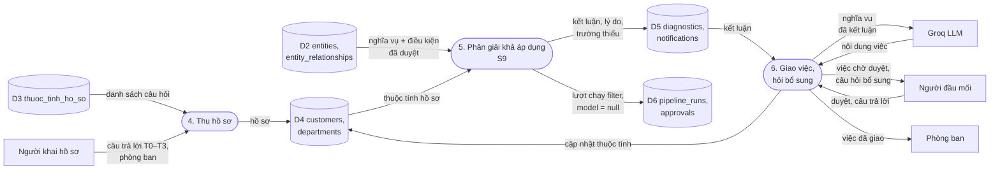

Ký hiệu: hình chữ nhật = tác nhân bên ngoài; hình bo tròn = tiến trình; hình trụ = kho dữ liệu (ghi tên bảng thật). D2 và D6 xuất hiện ở cả hai phần vì cả hai vòng cùng dùng.

---

## 8. Quy tắc quyết định của S9

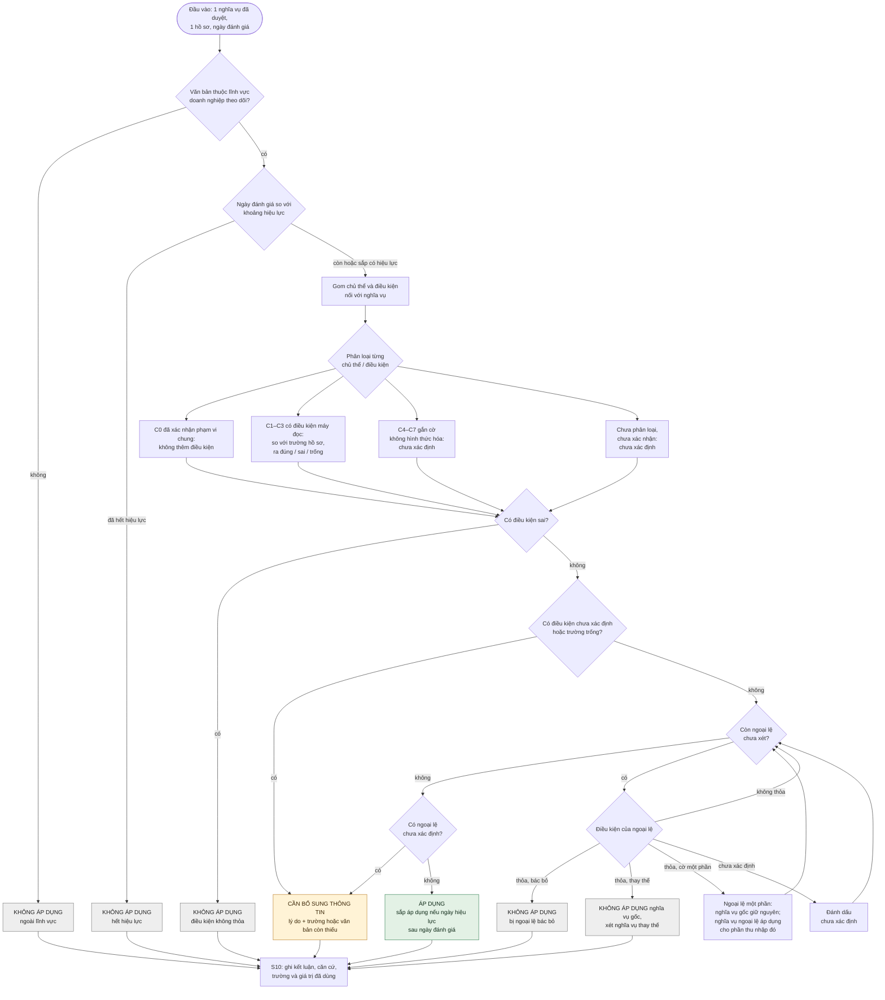

Màu ô kết luận: xanh = áp dụng; xám = không áp dụng; vàng = cần bổ sung thông tin.

**Quyết định chốt ngày 08/11.** Chủ thể hoặc điều kiện có `dieu_kien_may_doc = null` không còn được hiểu là "áp dụng cho mọi doanh nghiệp". Một nghĩa vụ áp dụng cho mọi doanh nghiệp chỉ khi chuyên viên đã xác nhận `pham_vi = chung` (C0). Mọi trường hợp chưa xác nhận → "cần bổ sung thông tin", lý do `thu_vien_chua_du`. Comment ở `ruleEngine.ts:117` (không điều kiện = áp dụng tất cả) bị bỏ. Ý của migration 005 (bắt xác nhận chủ thể chung) được giữ và nâng thành cột bắt buộc.

**Ba lý do của "cần bổ sung thông tin"**

| Lý do (đề xuất `diagnostics.ly_do`) | Khi nào | Ai xử lý tiếp |
|---|---|---|
| `thu_vien_chua_du` | Điều kiện C4, C5 mà văn bản đích chưa nạp; chủ thể chưa xác nhận phạm vi; C7 chưa ghi tường minh | Chuyên viên, ở Vòng 1 |
| `ho_so_thieu` | Trường hồ sơ dùng cho điều kiện C1–C3 bị trống hoặc "không chắc" | Người đầu mối |
| `can_chuyen_mon` | Điều kiện C6; dữ kiện T4 (quan hệ liên kết, chủ sở hữu hưởng lợi…) | Người đầu mối → chuyên gia bên ngoài hệ |

**Thứ tự xét**
- Các điều kiện nối bằng AND. Một điều kiện sai đủ để kết luận "không áp dụng", kể cả khi điều kiện khác chưa xác định.
- Ngoại lệ chỉ xét khi điều kiện gốc thỏa.
- Ngoại lệ có hai loại: **bác bỏ** (nghĩa vụ gốc không còn, không có gì thay) và **thay thế** (nghĩa vụ gốc được thay bằng nghĩa vụ khác — engine phải xét tiếp nghĩa vụ thay thế; bỏ bước này là bỏ sót nghĩa vụ).
- **Cờ ngoại lệ một phần** (`chi_mot_phan` trên cạnh ngoại lệ). Dùng khi ngoại lệ loại trừ một **loại thu nhập**, không loại trừ doanh nghiệp — ví dụ TNDN Đ18 k3: thu nhập từ trò chơi điện tử trên mạng không áp dụng thuế suất 15%, 17%, nhưng phần thu nhập còn lại của doanh nghiệp vẫn xét 15%, 17%. Ngoại lệ một phần **không bác bỏ** nghĩa vụ gốc: khi điều kiện ngoại lệ thỏa, nghĩa vụ gốc tiếp tục được xét (các ngoại lệ còn lại vẫn áp vào nó), và **nghĩa vụ ngoại lệ** (X3) áp dụng thêm cho phần thu nhập đó qua kết luận riêng của chính nó.
- Thứ tự giữa nhiều ngoại lệ của cùng một nghĩa vụ: xét hết; một ngoại lệ bác bỏ hoặc thay thế (không có cờ một phần) đã thỏa thì quyết định, kể cả khi ngoại lệ khác chưa xác định; nếu không có, còn ngoại lệ chưa xác định → cần bổ sung, lý do của ngoại lệ đó; còn lại → áp dụng. Đây là cùng nguyên tắc "sai thắng thiếu" ở điều kiện gốc.
- Mỗi cặp doanh nghiệp × nghĩa vụ chỉ nhận **một** kết luận. Hệ không chia nghĩa vụ theo phần thu nhập: phần thu nhập bị ngoại lệ một phần được thể hiện bằng kết luận của nghĩa vụ ngoại lệ (X3), không phải bằng kết luận thứ hai của nghĩa vụ gốc.
- MVP có trạng thái thứ tư `sap_ap_dung`. Trong báo cáo trình bày là biến thể của "áp dụng" khi ngày hiệu lực sau ngày đánh giá.

---

## 9. Bộ mã điều kiện C0–C7 và hồ sơ T0–T3

### 9.1 Bộ mã C0–C7 (bản nháp v1)

| Mã | Định nghĩa | Ví dụ thật (văn bản, điều, khoản) | Máy kết luận được? | Trường hồ sơ | Kết luận S9 |
|---|---|---|---|---|---|
| C0 | Áp dụng cho mọi đối tượng của văn bản | LDN Đ12 k3 †: "Doanh nghiệp phải bảo đảm luôn có ít nhất một người đại diện theo pháp luật cư trú tại Việt Nam." | Có, sau khi chuyên viên xác nhận phạm vi chung | — | Áp dụng |
| C1 | Ngưỡng định lượng | TNDN Đ10 k2 †: thuế suất 15% với doanh nghiệp "có tổng doanh thu năm không quá 03 tỷ đồng" (doanh thu kỳ tính thuế trước liền kề) | Có | T1: doanh thu kỳ trước | Áp dụng / không áp dụng / trống → cần bổ sung |
| C2 | Phân loại dứt khoát | LDN Đ31 k3 †: công ty cổ phần thông báo thay đổi cổ đông là nhà đầu tư nước ngoài. TNDN Đ18 k1 †: ưu đãi áp dụng với doanh nghiệp nộp thuế "theo phương pháp kê khai" | Có | T0: loại hình; T2: phương pháp nộp thuế | Như C1 |
| C3 | Theo sự kiện | LDN Đ30 k2 †: đăng ký thay đổi "trong thời hạn 10 ngày kể từ ngày có thay đổi". TNDN Đ5 k1 †: chọn năm tài chính khác năm dương lịch thì "thông báo với cơ quan thuế quản lý trực tiếp trước khi thực hiện" | Có | T3: cờ sự kiện + ngày | Như C1; có thời hạn tính từ ngày sự kiện |
| C4 | Dẫn chiếu ra văn bản khác | LDN Đ8 k1 †: đáp ứng điều kiện khi kinh doanh "ngành, nghề đầu tư kinh doanh có điều kiện" (danh mục nằm ở Luật Đầu tư). LDN Đ11 k2 †: "thời hạn lưu giữ thực hiện theo quy định của pháp luật" | Không, đến khi văn bản đích được nạp | — | Cần bổ sung, `thu_vien_chua_du` |
| C5 | Giao văn bản dưới luật quy định | TNDN Đ4 k14a (bổ sung bởi Luật 09/2026/QH16): miễn thuế với doanh nghiệp có doanh thu năm từ mức Chính phủ quy định trở xuống. TNDN Đ8 k2 †: "Chính phủ quy định chi tiết Điều này." | Không, đến khi nghị định được nạp | — | Cần bổ sung, `thu_vien_chua_du` |
| C6 | Thuật ngữ định tính | LDN Đ13 k1 điểm a †: người đại diện theo pháp luật thực hiện quyền, nghĩa vụ "một cách trung thực, cẩn trọng, tốt nhất" | Không | — | Cần bổ sung, `can_chuyen_mon`; hoặc không đưa vào tập nạp |
| C7 | Điều kiện ngầm, suy từ phạm vi chương / mục | LDN Đ127 k7 † (Chương V — Công ty cổ phần): "Công ty phải đăng ký thay đổi cổ đông trong sổ đăng ký cổ đông … trong thời hạn 24 giờ". Câu không ghi "công ty cổ phần"; điều kiện nằm ở tên chương | Không khi đọc riêng câu. Chuyên viên ghi tường minh → đổi mã thành C2 (có ghi vết) | Sau khi đổi: T0 loại hình | Trước: cần bổ sung. Sau: như C2 |
| T4 | Dữ kiện cần phán đoán pháp lý — **không thu** | TNDN Đ18 k4 †: không áp dụng thuế suất 15%, 17% với doanh nghiệp "là công ty con hoặc công ty có quan hệ liên kết" mà bên liên kết không đáp ứng điều kiện | Không — không hỏi trong hồ sơ | — | Cần bổ sung, `can_chuyen_mon` |

Ghi chú về bộ mã:
- Bộ mã là **bản nháp v1**, xây quy nạp từ một mẫu nhỏ. Cơ sở khái niệm: quyết định có cấu trúc / bán cấu trúc (Valacich và cộng sự, 2023, tr. 80–82); phân biệt quy tắc và tiêu chuẩn trong lý thuyết pháp luật (Kaplow, 1992); tính mở của thuật ngữ pháp lý (Hart, 1961); logic khả bác bỏ cho ngoại lệ.
- Quy trình hoàn thiện: hai người gán mã độc lập 20–30 quy định → tính Cohen's kappa → sửa định nghĩa các mã hay bị lẫn → gán toàn bộ. Có thể phát sinh mã mới; nếu có thì báo cáo như một kết quả.
- Kappa đo độ nhất quán giữa hai người gán, không đo tính đúng pháp lý. Tính đúng do chuyên gia bên ngoài nhóm kiểm (đã có người tiếp cận được).

### 9.2 Hồ sơ doanh nghiệp T0–T3 cho phạm vi ba luật

**Nguyên tắc**

1. Chỉ hỏi trường mà ít nhất một quy định C1–C3 **đã duyệt** dùng tới. Form sinh từ thư viện, không cố định: thêm hoặc bỏ quy định thì câu hỏi thêm hoặc bỏ theo.
2. Hỏi **dữ kiện**, không hỏi kết luận pháp lý (hỏi "có đổi cổ đông là nhà đầu tư nước ngoài không", không hỏi "có phải thông báo không").
3. Không hỏi T4.
4. Hỏi **khoảng** cắt đúng tại các ngưỡng có trong thư viện, không hỏi số chính xác. Thư viện có thêm ngưỡng → chia lại khoảng.
5. Hỏi có / không về sự kiện (kèm ngày nếu quy định tính hạn từ ngày đó), không hỏi chi tiết (tên cổ đông, giá trị chuyển nhượng).
6. Mỗi câu hiện điều khoản cần nó (lấy từ các quy định đã duyệt dùng trường đó).
7. Mọi trường dùng trong điều kiện có hai lựa chọn **"Không chắc"** và **"Không muốn trả lời"**. Cả hai → giá trị null → quy định liên quan "cần bổ sung", lý do `ho_so_thieu`. Hệ lưu riêng lựa chọn nào đã được chọn, để đo tỉ lệ từ chối trả lời theo từng câu.

**Phần 1 — hỏi khi đăng ký (ít nhạy cảm)**

| Tầng | Trường | Lựa chọn | Quy định dùng | Hiện khi |
|---|---|---|---|---|
| T0 | Loại hình | DNTN / TNHH một thành viên / TNHH hai thành viên trở lên / công ty cổ phần / hợp danh | LDN Chương III, V, VI, VII; Đ31 k3 | Luôn |
| T0 | Niêm yết hoặc đăng ký giao dịch chứng khoán | Có / không | LDN Đ31 k1 (sửa đổi 2025) — **chỉ giữ nếu quy định này nằm trong tập được chọn** | Loại hình = công ty cổ phần |
| T0 | Có chi nhánh, văn phòng đại diện hoặc địa điểm kinh doanh | Có / không | QLT 108 Đ10 (ứng viên) | Luôn |
| T2 | Phương pháp nộp thuế TNDN | Kê khai / tỷ lệ trên doanh thu | TNDN Đ11 k2; Đ18 k1 | Luôn |
| T2 | Kỳ tính thuế TNDN | Năm dương lịch / năm tài chính khác | TNDN Đ5 k1 | Luôn |
| T2 | Kỳ khai thuế | Theo tháng / theo quý | QLT 108 + NĐ 252/2026/NĐ-CP (ứng viên) | Luôn |
| — | Phòng ban và người đầu mối | Tên, mã phòng ban, email | Định tuyến (§6.2) | Luôn |

**Phần 2 — không hỏi lúc đăng ký; chỉ hỏi qua cơ chế "hỏi bổ sung" khi S9 cần**

Khi đăng ký, các trường này để trống → quy định dùng chúng nhận "cần bổ sung", `ho_so_thieu` → câu hỏi gửi người đầu mối, gom theo trường (một câu cho mọi quy định dùng cùng trường) → trả lời xong, S9 chạy lại cho các nghĩa vụ dùng trường đó (§11).

| Tầng | Trường | Lựa chọn | Quy định dùng | Hiện khi |
|---|---|---|---|---|
| T1 | Doanh thu kỳ tính thuế TNDN trước liền kề | ≤ 3 tỷ / > 3 đến 50 tỷ / > 50 tỷ / chưa có kỳ trước | TNDN Đ10 k2–k3; Đ4 k14a | S9 cần |
| T3 | Thu nhập thuộc nhóm nào ở TNDN Đ18 k3 | Điểm a / điểm b / điểm c (chọn nhiều) / không có. Điểm d là C5, không hỏi | TNDN Đ18 k3 a, b, c | Doanh thu ≤ 50 tỷ |
| T3 | Đổi ngành nghề hoặc thông tin đăng ký doanh nghiệp; ngày thay đổi | Có / không + ngày | LDN Đ30 k2, Đ31 k1–k2; QLT 108 Đ10 (ứng viên) | S9 cần |
| T3 | Đổi cổ đông là nhà đầu tư nước ngoài; ngày thay đổi | Có / không + ngày | LDN Đ31 k3 | Loại hình = công ty cổ phần |
| T3 | Chuyển nhượng hoặc nhận chuyển nhượng vốn, dự án đầu tư | Có / không | QLT 108 (ứng viên); TNDN Đ18 k3 a | S9 cần |

**Không hỏi (T4):** quan hệ liên kết (TNDN Đ18 k4), chủ sở hữu hưởng lợi (LDN sửa đổi 2025) → quy định phụ thuộc nhận "cần bổ sung", `can_chuyen_mon`. Thuộc tính `co_giao_dich_lien_ket` trong từ điển hiện tại thuộc T4, bỏ khỏi form.

**Ghi chú**
- Trường đánh dấu "ứng viên" chỉ chốt khi đã nạp toàn văn Luật 108 và gán mã xong; không có quy định C1–C3 đã duyệt nào dùng thì không hiện (nguyên tắc 1).
- Bỏ khỏi P0: mã ngành VSIC (LDN Đ8 k1 là C4; Đ18 k3 đã có câu hỏi theo nhóm thu nhập).
- Lựa chọn "chưa có kỳ trước": chuyên viên viết điều kiện máy đọc theo văn bản; văn bản chưa nạp có quy định cho doanh nghiệp mới thành lập → C5, `thu_vien_chua_du`.
- Hệ quả đo lường: ngay sau đăng ký, tỉ lệ "cần bổ sung" cao theo thiết kế (phần 2 chưa hỏi). Đo ở hai thời điểm: sau đăng ký và sau khi trả lời hỏi bổ sung (§14.4).

---

## 10. Ví dụ đối chiếu ba doanh nghiệp

Ba hồ sơ dưới đây là **hồ sơ minh họa**, không phải doanh nghiệp thật. Thử nghiệm với doanh nghiệp thật thuộc Chương X. Ngày đánh giá: 08/11/2026. Các quy định trích theo văn bản gốc † — phải đối chiếu bản hợp nhất.

### 10.1 Hồ sơ

| Trường | DN A | DN B | DN C |
|---|---|---|---|
| T0 Loại hình | Công ty cổ phần, chưa niêm yết | TNHH một thành viên | TNHH hai thành viên trở lên |
| T0 Ngành | Phần mềm | Phần mềm; bổ sung sản xuất trò chơi điện tử trên mạng ngày 05/11/2026 | Thương mại điện tử |
| T1 Doanh thu kỳ tính thuế TNDN trước (khoảng được hỏi; số minh họa) | ≤ 3 tỷ (2,5 tỷ) | > 3 đến 50 tỷ (20 tỷ) | > 50 tỷ (65 tỷ) |
| T2 Phương pháp nộp thuế | Kê khai | Kê khai | Kê khai |
| T2 Kỳ tính thuế | Năm dương lịch | Chuyển sang năm tài chính 01/4–31/3 | Năm dương lịch |
| T3 Thay đổi ngành nghề | Không | Có, 05/11/2026 | Không |
| T3 Thay đổi cổ đông là nhà đầu tư nước ngoài | Có, 03/11/2026 | Không hỏi (không phải công ty cổ phần) | Không hỏi (không phải công ty cổ phần) |
| T3 Nhóm thu nhập ở TNDN Đ18 k3 | Không có | Điểm c (trò chơi điện tử trên mạng) | Không hỏi (doanh thu > 50 tỷ) |
| T4 Quan hệ liên kết | Không hỏi | Không hỏi | Không hỏi |
| Phòng ban đã cấu hình (mã) | Kế toán (`ke_toan`), Ban giám đốc (`ban_giam_doc`) | Kế toán (`ke_toan`), Hành chính (`van_hanh`) | Kế toán (`ke_toan`), Ban giám đốc (`ban_giam_doc`) |

### 10.2 Quy định trong thư viện dùng cho ví dụ

| Mã | Quy định | Mã điều kiện | Ngoại lệ |
|---|---|---|---|
| L1 | LDN Đ12 k3: luôn có ít nhất một người đại diện theo pháp luật cư trú tại Việt Nam. Phòng ban gợi ý: `ban_giam_doc`, `van_hanh` | C0 | — |
| L2 | LDN Đ31 k1 (ngành nghề) + k2: thông báo thay đổi nội dung đăng ký trong 10 ngày kể từ ngày thay đổi. Phòng ban gợi ý: `ban_giam_doc`, `van_hanh` | C3 | — |
| L3 | LDN Đ31 k3: công ty cổ phần thông báo thay đổi cổ đông là nhà đầu tư nước ngoài trong 10 ngày | C2 + C3 | — |
| T1 | TNDN Đ5 k1: chọn năm tài chính khác năm dương lịch → thông báo cơ quan thuế quản lý trực tiếp trước khi thực hiện | C3; thủ tục thông báo theo Luật Quản lý thuế 108 (C4, liên kết sang văn bản thứ ba) | — |
| N1 | TNDN Đ10 k1: kê khai theo thuế suất 20% | C0 | Thay thế bởi N2 hoặc N3 khi điều kiện của chúng thỏa và không bị bác bỏ |
| N2 | TNDN Đ10 k2: kê khai theo thuế suất 15% | C1: doanh thu kỳ trước ≤ 3 tỷ | Bác bỏ bởi X3 — Đ18 k3 (theo loại thu nhập, C3, cờ một phần) và K4 — Đ18 k4 (T4) |
| N3 | TNDN Đ10 k3: kê khai theo thuế suất 17% | C1: 3 tỷ < doanh thu kỳ trước ≤ 50 tỷ | Như N2 |
| X3 | TNDN Đ18 k3 điểm c: thu nhập từ sản xuất, kinh doanh trò chơi điện tử trên mạng không áp dụng thuế suất 15%, 17% | C3 (nhóm thu nhập Đ18 k3 có điểm c) | Là ngoại lệ bác bỏ **có cờ một phần** của N2, N3 (§8): loại trừ loại thu nhập, không loại trừ doanh nghiệp |
| K4 | TNDN Đ18 k4: không áp dụng 15%, 17% với công ty con hoặc công ty có quan hệ liên kết mà bên liên kết không đáp ứng điều kiện | C6 / T4 | Là ngoại lệ bác bỏ (toàn phần) của N2, N3; điều kiện không hỏi được → chưa xác định, `can_chuyen_mon` |

### 10.3 Thứ tự xét nhóm quy định thuế suất (kiểm tra chéo)

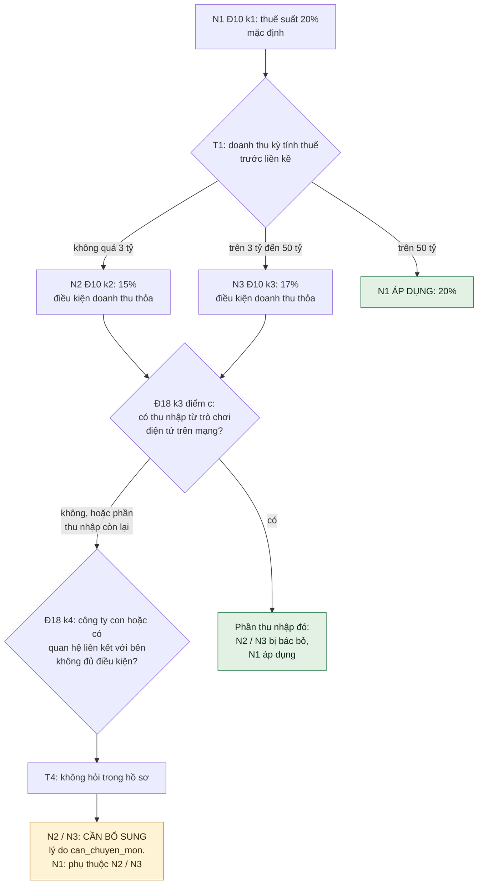

Màu như §8. Hai ô xanh là nơi kết luận được thuế suất 20%; ô vàng là nơi hệ dừng vì thiếu dữ kiện T4.

### 10.4 Kết quả

| Quy định | DN A | DN B | DN C | Phòng ban nhận |
|---|---|---|---|---|
| L1 (C0) | Áp dụng | Áp dụng | Áp dụng | Ban giám đốc (B: Hành chính `van_hanh`, vì không có Ban giám đốc trong cấu hình) |
| L2 (C3) | Không áp dụng — không có thay đổi | **Áp dụng**, hạn 15/11/2026 | Không áp dụng | Hành chính `van_hanh` / Ban giám đốc |
| L3 (C2 + C3) | **Áp dụng**, hạn 13/11/2026 | Không áp dụng — không phải công ty cổ phần | Không áp dụng — không phải công ty cổ phần | Ban giám đốc |
| T1 (C3, liên kết Luật 108) | Không áp dụng | **Áp dụng**, trước khi bắt đầu năm tài chính mới | Không áp dụng | Kế toán |
| N2 15% | **Cần bổ sung**: doanh thu thỏa; Đ18 k4 cần chuyên môn | Không áp dụng — doanh thu 20 tỷ | Không áp dụng | Kế toán |
| N3 17% | Không áp dụng | **Cần bổ sung** cho phần thu nhập không phải trò chơi điện tử: Đ18 k4 cần chuyên môn | Không áp dụng | Kế toán |
| X3 (Đ18 k3 c) | Không áp dụng | **Áp dụng**: phần thu nhập trò chơi điện tử trên mạng không dùng 17% | Không áp dụng | Kế toán |
| N1 20% | Cần bổ sung — phụ thuộc N2 | Áp dụng cho phần thu nhập trò chơi điện tử; phần còn lại phụ thuộc N3 | **Áp dụng** | Kế toán |

Cách hệ ghi các ô trên (mỗi cặp một kết luận, §8):
- **Hạn** (L2 của B, L3 của A): ngày 15/11, 13/11 là để người đọc kiểm tra. P0 **không tự tính ngày**; hệ hiển thị nguyên văn thời hạn ("trong thời hạn 10 ngày kể từ ngày có thay đổi") kèm ngày sự kiện doanh nghiệp đã khai (05/11/2026, 03/11/2026). Tính ngày hạn: P1.
- **B × N3:** cạnh X3 → N3 có cờ một phần nên N3 không bị bác bỏ; N3 tiếp tục xét K4 → chưa xác định → "cần bổ sung", `can_chuyen_mon`.
- **B × N1:** kết luận lưu là "cần bổ sung — phụ thuộc N3" (N3 là ngoại lệ thay thế của N1, đang chưa xác định). Phần thu nhập trò chơi điện tử dùng 20% được thể hiện bằng kết luận "áp dụng" của X3, không bằng kết luận thứ hai của N1.
- **A × N2:** X3 không thỏa (không có nhóm c); K4 chưa xác định → "cần bổ sung", `can_chuyen_mon`. A × N1 phụ thuộc N2 → "cần bổ sung".

### 10.5 Ví dụ này cho thấy gì

- **Phân hóa giữa doanh nghiệp:** L3 chỉ có ở A (công ty cổ phần). L2, T1, X3 chỉ có ở B (có sự kiện tương ứng). C là doanh nghiệp duy nhất được kết luận đầy đủ về thuế suất (20%), vì doanh thu trên 50 tỷ làm Đ18 k4 không còn liên quan.
- **Kiểm tra chéo:** kết luận thuế suất cần xét cùng lúc Đ10 k1, k2, k3, Đ18 k3, Đ18 k4, theo thứ tự ở §10.3. Engine MVP hiện tại (điều kiện một mệnh đề, nối AND, không có ngoại lệ) sẽ cho DN A đồng thời "áp dụng 20%" (N1, không điều kiện) và "áp dụng 15%" (N2, doanh thu ≤ 3 tỷ) — hai kết luận mâu thuẫn. Hai loại ngoại lệ ở §8 là để xử lý đúng trường hợp này.
- **Liên kết giữa các văn bản:** T1 (Luật TNDN) dẫn sang thủ tục thông báo ở Luật Quản lý thuế 108; L2, L3 (Luật Doanh nghiệp) và nhóm thuế suất (Luật TNDN) cùng phụ thuộc trường loại hình, ngành nghề.
- **Phân việc cho phòng ban khác nhau:** quy định Luật Doanh nghiệp về Ban giám đốc / Hành chính (`van_hanh`); quy định Luật TNDN về Kế toán.
- **Trạng thái "cần bổ sung" có lý do cụ thể:** A và B không được kết luận thuế suất 15% / 17% vì Đ18 k4 cần xác định quan hệ liên kết — dữ kiện hệ thống cố ý không thu (T4). Hệ nêu đúng điều khoản và dữ kiện còn thiếu.
- **Quy định giao Chính phủ (C5):** Đ4 k14a (miễn thuế theo ngưỡng do Chính phủ quy định) không đưa vào bảng vì ngưỡng nằm ở nghị định chưa nạp; mọi doanh nghiệp sẽ nhận "cần bổ sung", lý do `thu_vien_chua_du`, cho đến khi nghị định được nạp và S4 nối được dẫn chiếu.

---

## 11. Ba điểm chạy lại

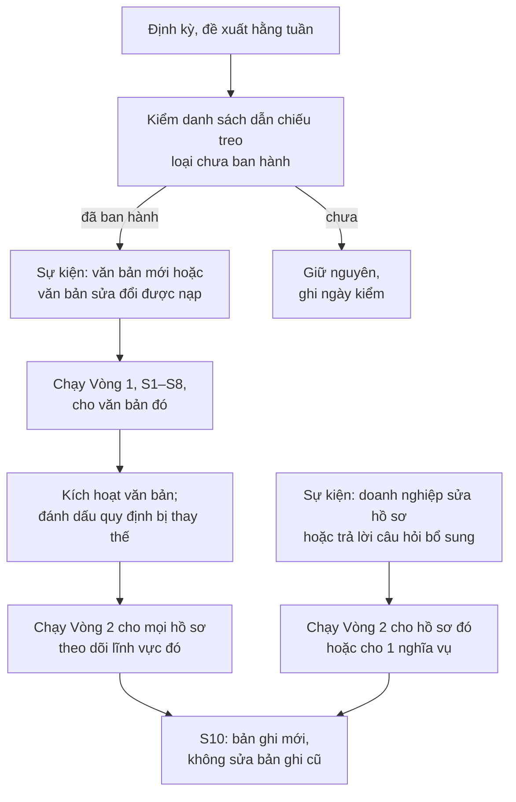

| Điểm chạy lại | Kích hoạt | Phạm vi | Mục đích | MVP |
|---|---|---|---|---|
| Vòng 1 | Văn bản mới hoặc sửa đổi được nạp | Văn bản đó | Đưa quy định mới vào thư viện; đánh dấu quy định bị thay thế | ✅ thủ công |
| Vòng 2, mọi hồ sơ | Văn bản được kích hoạt hoặc bị thay thế | Mọi hồ sơ theo dõi lĩnh vực | Doanh nghiệp đã được kết luận theo quy định cũ phải được kết luận lại theo quy định mới | 🟡 Nút bấm tay; kích hoạt không tự chạy lại |
| Vòng 2, một hồ sơ | Hồ sơ thay đổi; câu trả lời bổ sung | Hồ sơ đó, hoặc 1 nghĩa vụ | Cập nhật kết luận theo dữ kiện mới | ✅ |
| Kiểm dẫn chiếu treo | Định kỳ | Dẫn chiếu tới văn bản chưa ban hành | Phát hiện văn bản hướng dẫn vừa ban hành để nạp | ❌ |

Dẫn chiếu treo có hai loại, xử lý khác nhau:
- **Đã ban hành nhưng chưa nạp:** giới hạn vận hành; nạp thêm văn bản là hết. Ví dụ: TNDN Đ8 k2 "Chính phủ quy định chi tiết" → Nghị định 320/2025/NĐ-CP đã ban hành.
- **Chưa ban hành:** chưa có văn bản để nạp; chuyên gia cũng không trả lời được. Tỉ lệ quy định thuộc loại này là số đo về hệ thống văn bản pháp luật, không phải về phần mềm.

---

## 12. Mô hình dữ liệu

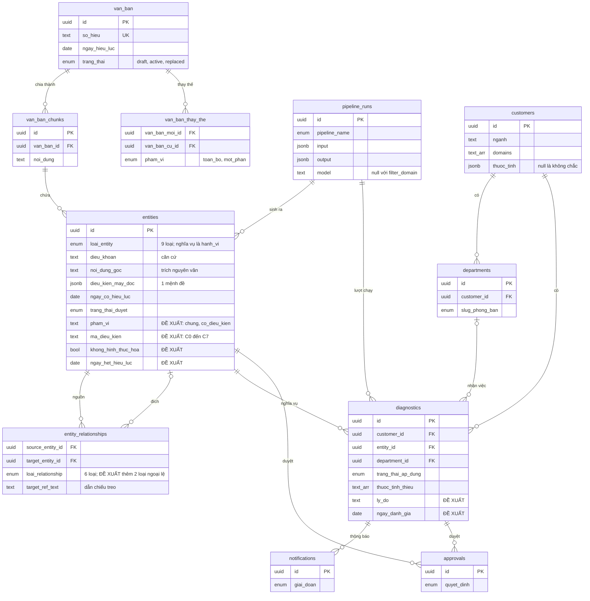

Cách mô hình hiện tại biểu diễn một nghĩa vụ: một dòng `entities` loại `hanh_vi`. Điều kiện áp dụng không nằm trên dòng đó mà nằm trên entity loại `chu_the`, `dieu_kien` hoặc `nguong`, nối bằng cạnh `dieu_kien` (điều kiện → hành vi) hoặc `ap_dung_cho` (hành vi → chủ thể). Mỗi entity điều kiện mang đúng một mệnh đề JSON `{thuoc_tinh, toan_tu, gia_tri}`; nhiều điều kiện chỉ nối bằng AND.

**Thay đổi đã chốt, chưa migrate**

| # | Thay đổi | Mục đích |
|---|---|---|
| 1 | `entities.pham_vi` (`chung` / `co_dieu_kien`), bắt buộc khi duyệt chủ thể; dữ liệu cũ null được coi là chưa xác nhận | Bỏ cách hiểu "không điều kiện = áp dụng tất cả" |
| 2 | `entities.ma_dieu_kien` (C0–C7), `entities.khong_hinh_thuc_hoa`, văn bản được dẫn chiếu | Lưu kết quả S6; S9 đọc được để trả "cần bổ sung" |
| 3 | Hai loại cạnh mới: `ngoai_le_bac_bo`, `ngoai_le_thay_the`; cờ `chi_mot_phan` trên cạnh ngoại lệ | Xử lý Đ18 k3 (một phần), Đ18 k4 và quan hệ thay thế giữa Đ10 k1, k2, k3 |
| 4 | `entities.ngay_het_hieu_luc`; S9 nhận `ngay_danh_gia`; S9 đọc `van_ban_thay_the` | Chọn đúng quy định có hiệu lực tại ngày đánh giá |
| 5 | `diagnostics.ly_do`; cho phép dòng diagnostic **chưa gắn phòng ban** ("cần bổ sung" luôn vậy; "áp dụng" khi không có phòng khớp và không có Ban giám đốc), người đầu mối chọn phòng khi duyệt | Không làm rơi kết luận; tách ba lý do |
| 6 | S10 ghi định danh phiên bản thư viện và bản chụp giá trị hồ sơ đã dùng | Kết luận cũ vẫn giải thích được sau khi luật hoặc hồ sơ đổi |
| 7 | Từ điển hồ sơ: trường thuộc phần 1 / phần 2, điều kiện hiện câu hỏi, kiểu ngày, khoảng; lưu riêng lý do để trống ("không chắc" / "không muốn trả lời") | Thiết kế hồ sơ §9.2 |

---

## 13. Trạng thái MVP ngày 08/11

### 13.1 Số đo trước can thiệp (DB production, 08/11/2026; chụp lại 09/11/2026 bằng script, `research/baseline/SUMMARY.md`)

| Mục | Số |
|---|---|
| Văn bản đang chạy | Luật 108/2025/QH15 (9 chunk), TT 77/2025/TT-BTC |
| Nghĩa vụ đã duyệt | 25 (18 của Luật 108, 7 của TT 77) |
| Luật 108: kết quả duyệt | 18 hành vi duyệt, 13 từ chối; 23 chủ thể duyệt, 5 từ chối; 5 điều kiện đều bị từ chối |
| Điều kiện máy đọc đang có | 5, tất cả `{nganh = chung_khoan}`, gắn với 5 chủ thể của TT 77 (kể cả "Cơ quan quản lý thuế") |
| Số tập nghĩa vụ phân biệt (Δ) | **2**: mọi doanh nghiệp nhận 18; doanh nghiệp ngành chứng khoán nhận 25. Tính lại bằng `ruleEngine.ts` trên thư viện ngày chụp (09/11). Ghi chú: kết quả **đã lưu** (lượt quét toàn bộ gần nhất của từng doanh nghiệp) cho Δ = 4 (18 / 19 / 25 / 26), vì 3 doanh nghiệp quét lần cuối khi Luật 109/2025/QH15 còn active (1 nghĩa vụ); văn bản này nay ở `draft` (§13.3) |
| Bảng `diagnostics` | 177 áp dụng · 26 không áp dụng · 0 cần bổ sung |
| "Cần bổ sung" engine đã tính nhưng không lưu | 7 (hồ sơ "SPAWNX REVIEW DEMO", `nganh = null`) |
| Nghĩa vụ được kết luận mà không có điều kiện đã xác nhận (tất định câm) | 18 / 25 = 72% |
| Hồ sơ | Thu 18 thuộc tính + 5 trường cố định; S9 dùng 2 (`domains`, `nganh`). Từ điển có 20 mã, trong đó `nganh`, `quy_mo` trùng với trường cố định |
| Kiểm thử tự động | 43 / 43 pass |
| Chất lượng đề xuất của LLM (86 thẻ kiểm thử nội bộ, giai đoạn trước) | Giữ 56% · sửa 10% · loại 34% (chưa xác minh đếm bằng script hay đếm tay) |

### 13.2 Ba lỗi đã truy ra dòng code

| Lỗi | Vị trí | Cơ chế | Sửa đã chốt |
|---|---|---|---|
| Không điều kiện = áp dụng tất cả (gốc của Δ = 2) | `ruleEngine.ts:126`, `filterDomain.ts:199` | Entity chủ thể / điều kiện không có `dieu_kien_may_doc` bị bỏ qua; nghĩa vụ còn 0 điều kiện → áp dụng | `pham_vi` bắt buộc; chưa xác nhận → cần bổ sung |
| "Cần bổ sung" bị rơi | `filterDomain.ts:286-292` | Kết luận được định tuyến như "áp dụng" theo phòng ban; doanh nghiệp không có phòng ban khớp và không có Ban giám đốc → không tạo dòng → không có thông báo hỏi bổ sung | Luôn tạo dòng, gửi người đầu mối |
| Không bao giờ thiếu dữ liệu | `lib/schemas.ts:18` | Form bắt buộc chọn ngành — trường duy nhất có điều kiện dùng | "Không chắc" cho mọi trường dùng trong điều kiện |

### 13.3 Rủi ro quản trị dữ liệu

- Cờ `nexora.seed` cho phép đổi trạng thái duyệt ngoài hàm duyệt nếu có quyền SQL trực tiếp. Hai nghĩa vụ Luật 108 có bản ghi "đã duyệt" nhưng hiện ở "từ chối"; chưa xác định ai đổi, khi nào.
- Kích hoạt văn bản (`draft` → `active`) cập nhật trực tiếp, không ghi `approvals`.
- 23 chủ thể Luật 108 được duyệt ngày 20/10, trước migration 005, nên không qua bước xác nhận phạm vi chung.
- Từ điển hồ sơ có thuộc tính T4 `co_giao_dich_lien_ket`.
- Luật 109/2025/QH15 đang ở `draft` nhưng có 1 nghĩa vụ đã duyệt. Văn bản từng ở `active`: 3 doanh nghiệp có lượt quét toàn bộ gần nhất chạy lúc đó, nên kết quả đã lưu của họ còn nghĩa vụ này (gốc của Δ = 4 trong kết quả đã lưu, §13.1). Chuyển `active` → `draft` không qua hàm duyệt, không ghi `approvals`, không tự quét lại.
- Comment trong `scripts/seed-demo.mjs` ghi điều kiện TT 77 dùng `co_giay_phep_kinh_doanh_chung_khoan`; DB thật dùng `nganh`.

### 13.4 Giới hạn phải nói khi trình bày

1. Thư viện mới có 2 văn bản. Hai văn bản mục tiêu (Luật Doanh nghiệp, Luật Thuế TNDN) chưa nạp; file hiện có chưa hợp nhất.
2. Chưa có S6: mã C0–C7 chưa được lưu trong hệ.
3. S9 chưa xử lý ngoại lệ, chưa có ngày hết hiệu lực, chưa đọc quan hệ thay thế.
4. S4 mới ghi lại cụm dẫn chiếu, chưa giải.
5. Δ = 2 và 0 kết luận "cần bổ sung" được lưu là do ba lỗi ở §13.2, đã truy ra dòng code.
6. Trước thử nghiệm SME, chỉ có 1 người dùng thật (Nexora Technology).
7. Hệ không tự phát hiện văn bản mới.

---

## 14. Việc cần làm đến code freeze 19/11

### 14.1 P0 — bắt buộc

| # | Việc | Giai đoạn | Nhóm việc theo sườn | Hạn đề xuất |
|---|---|---|---|---|
| 1 | Lấy bản hợp nhất Luật Doanh nghiệp (59/2020 + 03/2022 + 76/2025) và Luật Thuế TNDN (67/2025 + các luật sửa đổi); ghi khoản bị sửa, văn bản sửa, ngày hiệu lực | S2 | P0.1 | 10/11 |
| 2 | Nạp toàn văn Luật 108 (đề xuất cũ của 9 điều nạp lại ở `cho_duyet`, các điều còn lại trích xuất mới); chọn 25–40 quy định LDN + TNDN theo §2.2; nạp qua S1–S5 | S1–S5 | P0.1 | 12/11 |
| 3 | Hai người gán mã C0–C7 độc lập 20–30 quy định; tính kappa; sửa sổ tay mã; gán toàn bộ | S6 | P0.1 | 13/11 |
| 4 | Migration các thay đổi 1–5 ở §12 | S8 | P0.2 | 12/11 |
| 5 | Sửa S9: chưa xác nhận ≠ áp dụng; xét hai loại ngoại lệ; ngày đánh giá; ngày hết hiệu lực | S9 | P0.2 | 14/11 |
| 6 | Sửa định tuyến: "cần bổ sung" → người đầu mối | S9–S10 | P0.2 | 13/11 |
| 7 | Hồ sơ theo §9.2: phần 1 khi đăng ký, phần 2 qua hỏi bổ sung; câu hỏi sinh từ quy định đã duyệt, hiện điều khoản; khoảng thay cho số; "Không chắc" / "Không muốn trả lời" lưu riêng; bỏ `co_giao_dich_lien_ket` và VSIC | Hồ sơ | P0.2 | 13/11 |
| 8 | Duyệt lại Luật 108 trên CSDL mới: 9 điều cũ (gồm 23 chủ thể — xác nhận phạm vi chung hoặc gắn điều kiện) và các điều mới trích xuất | S7 | P0.1 | 13/11 |
| 9 | Script đo trước / sau trên hồ sơ SME thật và bộ hồ sơ tổng hợp phủ các ngưỡng | Đo | P0.3 | 15/11 |

**Điểm cắt:** đến 15/11 chưa có số đo sau can thiệp → dừng code, viết báo cáo bằng số trước can thiệp (§13.1) và bảng gán mã tay (theo ghi chú Chương IX của sườn).

### 14.2 P1 — chỉ làm nếu P0 xong trước 15/11

- Tính ngày hạn cụ thể từ ngày sự kiện (P0 chỉ hiển thị nguyên văn thời hạn + ngày sự kiện).
- Bảng quy tắc vai cho S7 (ví dụ: chủ thể của hành vi "chịu phạt" phải thuộc nhóm đối tượng bị quản lý, không thuộc nhóm cơ quan nhà nước).
- Phân loại dẫn chiếu treo hai loại ở S4.
- Khóa cờ `nexora.seed` trên production; hàm kích hoạt văn bản có ghi `approvals`.
- Sửa `CLAUDE.md` và các tài liệu lệch code.

### 14.3 Không làm trước 21/11 (ghi vào Chương XIII)

Tự phát hiện văn bản mới · hợp nhất tự động · giải dẫn chiếu ngoại bộ trên toàn bộ văn bản liên quan · lịch hạn và nhắc việc tự động · ghi nhận bằng chứng hoàn thành nghĩa vụ.

### 14.4 Bảng chỉ số trước / sau

Cột "Dự đoán sau" nhóm điền **trước khi** chạy đo và giữ nguyên dù kết quả khác. Kết quả ngược dự đoán → kiểm lại bộ mã và phần triển khai trước khi kết luận.

| Chỉ số | Công thức | Trước (08/11) | Dự đoán sau | Kết quả |
|---|---|---|---|---|
| Δ | Số tập nghĩa vụ "áp dụng" khác nhau trên tập hồ sơ | 2 | | |
| Tỉ lệ cần bổ sung | Số cặp doanh nghiệp × nghĩa vụ ra "cần bổ sung" / tổng số cặp. Đo hai thời điểm: sau đăng ký, sau khi trả lời hỏi bổ sung; tách theo ba lý do | 0% (đã lưu) | | |
| Tỉ lệ từ chối theo câu | Số doanh nghiệp chọn "Không muốn trả lời" / số doanh nghiệp được hỏi câu đó (tách riêng "Không chắc") | Chưa đo | | |
| Tỉ lệ tất định câm | Số nghĩa vụ được kết luận áp dụng / không áp dụng mà không có điều kiện đã xác nhận / tổng số nghĩa vụ | 72% | | |
| D(S) | Số nghĩa vụ kết luận được chỉ từ các trường hồ sơ S / tổng số nghĩa vụ | Chưa đo | | |
| Phân bố C0–C7 | Đếm theo mã | Chưa đo | | |

Gợi ý để nhóm tự chốt dự đoán: Δ có cơ sở để tăng vì có điều kiện theo loại hình (Luật Doanh nghiệp) và theo ngưỡng doanh thu (Luật TNDN); tỉ lệ cần bổ sung có cơ sở để tăng vì Đ18 k4 TNDN và các dẫn chiếu C4, C5; tỉ lệ tất định câm phải về 0 nếu thay đổi 1 ở §12 được triển khai đúng — chỉ số này kiểm việc triển khai, không phải phát hiện.

---

## 15. Thứ tự trình bày cho clip

| Bước | Sơ đồ / mục | Nội dung nói |
|---|---|---|
| 1 | §1 | Đầu vào, đầu ra, những việc hệ không làm |
| 2 | §3 sơ đồ khối | Các thành phần; hai chỗ có LLM; S9 là code |
| 3 | §4 lưu đồ | Hai vòng; ranh giới LLM; mọi mục vào thư viện đều qua người duyệt; màu = trạng thái MVP |
| 4 | §6.1, §6.2 sơ đồ làn | Ai làm bước nào trong từng vòng |
| 5 | §8 quy tắc S9 | Ba kết luận; ba lý do của "cần bổ sung"; quyết định chốt về chủ thể chưa xác nhận |
| 6 | §10 ví dụ ba doanh nghiệp | Phân hóa, kiểm tra chéo Đ10 / Đ18, phân việc cho phòng ban, lý do "cần bổ sung" |
| 7 | §13 trạng thái MVP | Số đo trước can thiệp; ba lỗi đã truy ra; giới hạn |
| 8 | §14 | Việc làm đến 19/11; bảng chỉ số trước / sau |

---

## Phụ lục A. Đối chiếu với sườn báo cáo

| Mục trong sườn | Đang ghi | Sửa thành |
|---|---|---|
| I.5 Phạm vi | Nguồn: Luật 108/2025/QH15 và TT 77/2025/TT-BTC | Luật Doanh nghiệp (bản hợp nhất, 25–40 quy định chọn), Luật Thuế TNDN (bản hợp nhất, chọn cùng tập), Luật Quản lý thuế 108/2025/QH15 (toàn văn). NĐ 252/2026/NĐ-CP, TT 90/2026/TT-BTC: chưa quyết. TT 77 chỉ là dữ liệu trước can thiệp |
| I.7 Đóng góp mới | (1) HTTT tất định ở tầng xác định nghĩa vụ, đặt đầu | Đặt bộ mã C0–C7 cùng phép đo lên đầu; giữ thiết kế ba trạng thái; artifact ở tầng xác định nghĩa vụ trình bày như một thiết kế được thử nghiệm, không tuyên bố mới so với phần mềm thuế thương mại — đưa các phần mềm này vào bảng VI.2 |
| VII, dòng "Ch.6 CSDL" | Mô hình văn bản → điều → nghĩa vụ → điều kiện → phòng ban | Dùng mô hình thật §12: `van_ban` → `van_ban_chunks` → `entities` + `entity_relationships`; `customers` + `departments` → `diagnostics` |
| VIII.1 bảng hai vòng | Vòng 2: "Không dùng AI"; con người: "Không cần" | Quyết định khả áp dụng không dùng LLM (CSDL ép `model IS NULL`). Sau quyết định, LLM soạn nội dung việc; người đầu mối duyệt nội dung và trả lời câu hỏi bổ sung |
| VIII.2 Ba trạng thái | Ba trạng thái | Thêm ba lý do của "cần bổ sung" (§8); `sap_ap_dung` là biến thể của "áp dụng" |
| VIII.3 Pipeline | Định tuyến theo loại điều kiện (sơ đồ HTML cho C0–C2 vào thẳng thư viện) | Mọi mục qua người duyệt; định tuyến quyết định loại thao tác duyệt (§4, điểm 3). Ngọc vẽ lại theo §4 |
| VIII.4 C0–C7 | Ví dụ chung | Dùng ví dụ thật ở §9.1; ghi "bản nháp v1" |
| VIII.5 T0–T3 | Bốn tầng chung | Dùng §9.2: bảy nguyên tắc, hồ sơ hai phần (đăng ký / hỏi bổ sung); nêu việc bỏ `co_giao_dich_lien_ket` và VSIC |
| VIII.6 ERD | Mô hình rút gọn | ERD §12 |
| IX.1 Ngăn xếp | "Pipeline AI 4 bước Extract → Filter → Generate → Rescan" | Bốn điểm chạy: Extract (LLM), Filter (code), Generate (LLM), Rescan (code) |
| IX.3 Đã xây | S1, S3, S5, S7 cơ bản, S8, một phần S10 | Thêm: ràng buộc "LLM không ghi thẳng vào thư viện" ép ở CSDL; kiểm trích dẫn bằng code; định tuyến phòng ban, người đầu mối duyệt, thông báo, hộp thư phòng ban |
| IX.4 Hiện trạng | 25 nghĩa vụ; 18 / 7 / 0; Δ = 2 | Thêm số §13.1: 177 / 26 / 0 trong `diagnostics`; 7 "cần bổ sung" đã tính nhưng không lưu; 20 thuộc tính thu, 2 dùng; 72% tất định câm |
| IX.5 Dự đoán | Δ "Vẫn thấp" | Viết lại dự đoán cho thư viện ba luật trước khi đo (§14.4) |
| XII Pháp lý, đạo đức | Năm ý | Thêm: rủi ro của bước LLM soạn nội dung việc và quy tắc soạn (§6.2); việc bỏ thuộc tính T4 khỏi form |
| XIII Giới hạn | Bảng tám dòng | Thêm: văn bản phải hợp nhất (§2.3); rủi ro quản trị dữ liệu (§13.3); tài liệu repo lệch code |

---

## Phụ lục B. Thuật ngữ

| Thuật ngữ | Nghĩa trong tài liệu này |
|---|---|
| Quy định / nghĩa vụ | Một đơn vị trong thư viện; trong CSDL là entity loại `hanh_vi` đã duyệt, kèm điều khoản căn cứ |
| Điều kiện áp dụng | Điều kiện để một quy định áp dụng cho một doanh nghiệp, ví dụ "doanh thu kỳ trước ≤ 3 tỷ" |
| Khả áp dụng | Quy định có áp dụng cho một doanh nghiệp cụ thể tại một ngày cụ thể hay không |
| Điều kiện máy đọc | Điều kiện viết dạng `{thuoc_tinh, toan_tu, gia_tri}` để code so với hồ sơ |
| Tất định | Cùng đầu vào và cùng phiên bản thư viện luôn cho cùng kết quả |
| Tất định câm | Hệ đưa ra kết luận áp dụng / không áp dụng khi không có điều kiện đã xác nhận làm căn cứ |
| Khung deontic | Cách biểu diễn quy phạm gồm: chủ thể, toán tử (bắt buộc / cấm / được phép), hành vi, điều kiện, ngoại lệ, thời hạn, căn cứ |
| Ngoại lệ bác bỏ | Khi điều kiện ngoại lệ thỏa, nghĩa vụ gốc không áp dụng và không có nghĩa vụ thay |
| Ngoại lệ thay thế | Khi điều kiện ngoại lệ thỏa, nghĩa vụ gốc được thay bằng nghĩa vụ khác |
| Ngoại lệ một phần | Ngoại lệ chỉ loại trừ một phần (ví dụ một loại thu nhập); nghĩa vụ gốc vẫn được xét, nghĩa vụ ngoại lệ áp dụng cho phần đó |
| Hỏi bổ sung | Câu hỏi gửi người đầu mối khi S9 thiếu dữ kiện hồ sơ; cũng là cách duy nhất hỏi các trường phần 2 của hồ sơ (§9.2) |
| Dẫn chiếu treo | Dẫn chiếu tới văn bản chưa có trong thư viện; hai loại: đã ban hành chưa nạp, chưa ban hành |
| Hợp nhất văn bản | Ghép văn bản gốc với các văn bản sửa đổi để có nội dung đang có hiệu lực |
| Kiểm trích dẫn nguyên văn | Kiểm đoạn trích của đề xuất có xuất hiện đúng trong điều được nêu |
| Ràng buộc vai | Mỗi vai trong khung deontic chỉ nhận thực thể đúng loại |
| Người đầu mối | Người của doanh nghiệp duyệt việc trước khi giao và trả lời câu hỏi bổ sung |
| Diagnostic | Một dòng kết quả: 1 nghĩa vụ × 1 phòng ban × 1 doanh nghiệp |
| Δ | Số tập nghĩa vụ "áp dụng" khác nhau mà hệ sinh ra trên một tập hồ sơ |
| D(S) | Tỉ lệ nghĩa vụ kết luận được chỉ bằng các trường hồ sơ S |

---

## Phụ lục C. Nguồn

Tài liệu nội bộ
- `UNDERSTANDING.md` — báo cáo đọc hiểu codebase, repo `main@9c62ff2`, ngày 08/11/2026.
- `nexora-pipeline-cai-tien.html` — sơ đồ pipeline 10 giai đoạn, ngày 05/11/2026.
- Sườn báo cáo đồ án MIS (Google Docs), bản ngày 08/11/2026.

Văn bản pháp luật (file nhóm cung cấp — bản gốc)
- Luật Doanh nghiệp 59/2020/QH14.
- Luật Thuế thu nhập doanh nghiệp 67/2025/QH15.
- Thông tư 77/2025/TT-BTC.

Văn bản sửa đổi và văn bản hướng dẫn (tra cứu ngày 08/11/2026)
- Luật 76/2025/QH15 sửa đổi Luật Doanh nghiệp: https://thuvienphapluat.vn/van-ban/Doanh-nghiep/Luat-Doanh-nghiep-sua-doi-2025-so-76-2025-QH15-659899.aspx
- Tóm tắt điểm mới Luật 76/2025/QH15: https://lsvn.vn/nhung-diem-moi-tai-luat-sua-doi-luat-doanh-nghiep-co-hieu-luc-tu-01-7-2025-a159727.html
- Luật 09/2026/QH16 sửa đổi Luật Thuế TNCN, GTGT, TNDN, TTĐB: https://ketoanthienung.net/luat-so-09-2026-qh16-sua-doi-luat-thue-tncn-gtgt-tndn.htm
- Tin Quốc hội thông qua Luật sửa đổi bốn luật thuế, 24/4/2026: https://thitruongtaichinhtiente.vn/quoc-hoi-thong-qua-luat-sua-doi-4-luat-ve-thue-nang-muc-doanh-thu-mien-thue-82427.html
- Hiệu lực các quy định về ngưỡng doanh thu từ 01/01/2026: https://thoibaotaichinhvietnam.vn/chinh-phu-duoc-quyet-dinh-nguong-doanh-thu-mien-thue-du-kien-1-ty-dongnam-196307.html
- Thông tư 20/2026/TT-BTC và Nghị định 320/2025/NĐ-CP hướng dẫn Luật Thuế TNDN: https://thuvienphapluat.vn/documents/law.aspx?id=U%3DpjeU5UTTTm

Tài liệu học thuật dẫn trong §9.1
- Hart, H. L. A. (1961). *The Concept of Law*. Oxford University Press.
- Kaplow, L. (1992). Rules versus standards: An economic analysis. *Duke Law Journal, 42*(3), 557–629.
- Valacich, J., Schneider, C., & Hashim, M. (2023). *Information Systems Today: Managing in the Digital World* (9th ed., Global ed.). Pearson.

---

## Nhật ký thay đổi thiết kế

Từ 09/11/2026, `docs/mis/HE_THONG_DA_CHOT.md` trong repo là bản chuẩn duy nhất. Mỗi thay đổi ghi ngày, nội dung, mục bị sửa, lý do.

### 09/11/2026 — phiên bản 1.1

| # | Thay đổi | Mục sửa | Lý do |
|---|---|---|---|
| 1 | **Ngoại lệ một phần** (Q1): thêm cờ `chi_mot_phan` trên cạnh ngoại lệ. Ngoại lệ một phần không bác bỏ nghĩa vụ gốc; khi điều kiện thỏa, nghĩa vụ ngoại lệ (X3 — TNDN Đ18 k3) áp dụng thêm cho phần thu nhập đó. Bổ sung thứ tự xét giữa nhiều ngoại lệ; mỗi cặp DN × nghĩa vụ một kết luận. Giữ nguyên kết luận §10.4, thêm ghi chú cách hệ ghi các ô | §8 (lưu đồ + thứ tự xét), §10.2 (X3, thêm K4), §10.4 (ghi chú), §12 #3, Phụ lục B | Đ18 k3 loại trừ loại thu nhập, không loại trừ doanh nghiệp. Bản 1 để §8 (bác bỏ → không áp dụng) mâu thuẫn với §10.4 |
| 2 | **Phòng "Hành chính"** (Q2): không thêm mã phòng ban; trong ví dụ gắn `van_hanh`. L1, L2 gợi ý `ban_giam_doc`, `van_hanh` | §10.1, §10.2, §10.4 | "Hành chính" không có trong 8 mã `slug_phong_ban` |
| 3 | **Nghĩa vụ không có phòng nhận** (Q3): DN không có phòng khớp và không có Ban giám đốc → tạo dòng chưa gắn phòng ban, người đầu mối chọn khi duyệt | §6.2, §12 #5 | Bản 1 (và code) bỏ rơi kết luận trong trường hợp này |
| 4 | **Nạp lại sang CSDL mới** (Q4): chỉ nạp lại đề xuất cũ của Luật 108 (9 điều), ở `cho_duyet`. Không nạp TT 77, Luật 109 | §2.1, §14.1 #2, #8 | So sánh trước / sau dùng cùng bộ đề xuất LLM; TT 77 chỉ là dữ liệu trước can thiệp |
| 5 | **Hạn cụ thể** (Q5): sang P1. P0 hiển thị nguyên văn thời hạn trong luật + ngày sự kiện, không tự tính ngày | §6.2, §10.4 (ghi chú), §14.2 | Không có điều kiện thời hạn máy đọc trong §12; không kịp hạn |
| 6 | **VSIC, niêm yết** (Q6): bỏ VSIC khỏi P0. "Niêm yết" chỉ giữ nếu LDN Đ31 k1 (sửa đổi 2025) nằm trong tập quy định được chọn; chỉ hiện với công ty cổ phần | §9.2 | Nguyên tắc 1 của §9.2: không quy định C1–C3 nào trong tập đang xét dùng VSIC |
| 7 | **Số liệu trước can thiệp:** báo cáo dùng Δ = 2 (tính lại trên thư viện ngày chụp), ghi chú Δ = 4 trong kết quả đã lưu và lý do (Luật 109). "20 + 5" sửa thành "18 + 5". Thêm rủi ro Luật 109 ở `draft` nhưng có nghĩa vụ đã duyệt | §5 (dòng Hồ sơ), §13.1, §13.3 | Chụp lại bằng script ngày 09/11 (`research/baseline/SUMMARY.md`) |
| 8 | **Phạm vi Luật Quản lý thuế** (thay đổi 1): nạp **toàn văn** Luật 108/2025/QH15 (hiệu lực 01/7/2026, thay Luật 38/2019/QH14), không chỉ 9 điều. **Câu hỏi mở:** có nạp NĐ 252/2026/NĐ-CP và TT 90/2026/TT-BTC không; nếu không, nghĩa vụ dẫn chiếu sang đó là C5 → cần bổ sung, `thu_vien_chua_du` | §2.1, §2.2, §14.1 #2, Phụ lục A (I.5) | Thủ tục khai, nộp có nhiều dẫn chiếu nội bộ; nạp rời từng điều làm S4 không nối được |
| 9 | **Hồ sơ doanh nghiệp** (thay đổi 2): thay §9.2 — bảy nguyên tắc (chỉ hỏi trường quy định C1–C3 đã duyệt dùng; hỏi dữ kiện không hỏi kết luận; không hỏi T4; hỏi khoảng tại ngưỡng; hỏi có/không về sự kiện; hiện điều khoản; "Không chắc" và "Không muốn trả lời" → null, lưu riêng lý do). Phần 1 hỏi khi đăng ký; phần 2 chỉ hỏi qua hỏi bổ sung khi S9 cần. Trường "ứng viên" chốt sau khi nạp toàn văn Luật 108 và gán mã | §5 (dòng Hồ sơ), §9.2, §10.1, §12 #7, §14.1 #7, §14.4 (đo hai thời điểm, tỉ lệ từ chối theo câu), Phụ lục A (VIII.5), Phụ lục B | Giảm câu hỏi nhạy cảm lúc đăng ký; đo được hồ sơ nào thiếu vì doanh nghiệp không biết hay không muốn trả lời |
