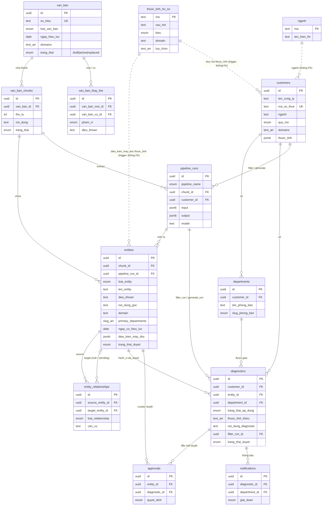

# UNDERSTANDING.md — Đọc hiểu hệ thống Nexora Compliance Navigator (hiện trạng)

> Lập ngày 08/11/2026, trên `main` @ `9c62ff2`. **Không sửa dòng code nào.**
>
> **Nguồn đã dùng:**
> 1. Source code, migration SQL, script trong repo (đọc trực tiếp).
> 2. Dữ liệu thật trên Supabase production: chỉ chạy **truy vấn GET chỉ đọc** qua PostgREST ngày 08/11 (không ghi gì). Số liệu DB trong file này lấy từ các truy vấn đó.
> 3. `npm test`: 43/43 test pass (Node v24.16.0).
>
> Ký hiệu: ✅ có · 🟡 có nhưng thiếu/sai · ❌ không có · ❓ chưa xác định.

---

## 0. Tóm tắt 1 phút

- Kiến trúc thực tế **không còn** là mô hình `cards / tasks / customer_profiles` mà `CLAUDE.md` mô tả. Migration `002_ner_graph.sql` đã DROP toàn bộ các bảng đó và thay bằng: **`van_ban → van_ban_chunks → entities + entity_relationships`** (thư viện nghĩa vụ dạng đồ thị) và **`customers + departments → diagnostics`** (kết quả đối chiếu). `CLAUDE.md`, `supabase/schema.sql`, `seed.sql`, `seed_customers.sql`, `docs/api-contract.md` đều mô tả mô hình đã chết.
- Một "nghĩa vụ" = một entity loại `hanh_vi` đã duyệt. **Điều kiện áp dụng không nằm trên nghĩa vụ** mà nằm trên entity khác (`dieu_kien` / `nguong` / `chu_the`), nối với `hanh_vi` bằng cạnh, dưới dạng JSON máy đọc `{thuoc_tinh, toan_tu, gia_tri}` do **curator điền tay**.
- Rule engine (`lib/pipeline/ruleEngine.ts`) là code thuần, có **4** trạng thái (thêm `sap_ap_dung` so với thiết kế đích 3 trạng thái), **có** nhánh `chua_du_thong_tin`.
- **Lỗi (a) — chỉ 2 tập nghĩa vụ:** không phải lỗi rẽ nhánh sai trong code mà là *code coi "không có điều kiện" = "áp dụng cho mọi doanh nghiệp"* (`ruleEngine.ts:117,126`) **cộng với** thư viện thật chỉ có đúng 1 loại điều kiện: `nganh = chung_khoan` (5 chủ thể của TT 77). 18 nghĩa vụ của Luật 108 có **0** điều kiện có hiệu lực → áp dụng cho mọi doanh nghiệp theo dõi lĩnh vực `thue`.
- **Lỗi (b) — 0 "cần bổ sung":** nhánh tồn tại và đã từng chạy, nhưng chỉ kích hoạt khi một điều kiện đọc thuộc tính mà hồ sơ để trống. Điều kiện duy nhất đọc `nganh`, mà form bắt buộc chọn ngành → không bao giờ trống. Thêm một chỗ làm mất kết quả: kết quả `chua_du_thong_tin` không được lưu thành diagnostic khi doanh nghiệp không có phòng ban khớp (`filterDomain.ts:286-292`).

---

## 1. Cấu trúc repo, stack, cách chạy local

### 1.1. Cây thư mục (bỏ `node_modules`, `public`, `.claude/skills`, `.agents`, `.codex`)

```
.
├── CLAUDE.md                 # ⚠ mô tả mô hình cards/tasks đã bị DROP — lỗi thời
├── AGENTS.md, README.md
├── app/                      # Next.js App Router
│   ├── (curator)/            # màn chuyên viên pháp lý
│   │   ├── nhap-van-ban/     #   nhập văn bản + chunk
│   │   ├── duyet-ban-nhap/   #   duyệt entity (Round 1)
│   │   ├── kho-entity/       #   xem thư viện
│   │   ├── nhat-ky/          #   pipeline_runs
│   │   └── quet-lai/         #   nút "Quét lại khách hàng hiện có"
│   ├── (khach-hang)/         # màn doanh nghiệp
│   │   ├── onboarding/       #   form hồ sơ 4 bước
│   │   ├── tong-quan/        #   kết quả đối chiếu
│   │   ├── duyet-diagnostic/ #   người đầu mối duyệt việc cần làm
│   │   └── hop-thu/          #   hộp thư phòng ban
│   ├── api/
│   │   ├── pipeline/extract/route.ts   # Round 1: AI trích xuất 1 chunk
│   │   ├── pipeline/filter/route.ts    # Round 2: rule engine 1 DN (tùy chọn 1 entity)
│   │   ├── pipeline/rescan/route.ts    # Round 2: rule engine mọi DN
│   │   ├── pipeline/generate/route.ts  # AI viết nội dung checklist
│   │   ├── onboard/route.ts            # đăng ký DN + quét ngược
│   │   ├── onboard/[id]/route.ts       # đọc / chạy lại quét cho 1 DN
│   │   └── keep-alive/route.ts         # cron chống Supabase pause
│   ├── login/, dang-ky/, page.tsx (landing)
├── components/nexora/        # UI nghiệp vụ (onboarding-form, draft-review, dieu-kien-editor, hoi-bo-sung…)
├── components/ui/            # shadcn
├── lib/
│   ├── pipeline/
│   │   ├── extractEntities.ts (+ .prompt.ts, .schema.ts)  # Round 1 — gọi Groq
│   │   ├── grounding.ts                                    # Round 1 — kiểm trích dẫn nguyên văn (code thuần)
│   │   ├── ruleEngine.ts                                   # Round 2 — lõi quyết định (code thuần)
│   │   ├── filterDomain.ts                                 # Round 2 — đọc DB, gọi ruleEngine, ghi diagnostics
│   │   ├── phanBoDiagnostic.ts, quetNguoc.ts
│   │   ├── generateDiagnostic.ts (+ .prompt.ts)            # AI viết lại checklist
│   │   ├── runs.ts (ghi pipeline_runs), groqLimit.ts
│   ├── onboard.ts            # validate body /api/onboard, đoán slug phòng ban, tổng hợp kết quả
│   ├── schemas.ts            # Zod cho form (onboarding, văn bản, chunk)
│   ├── parse-van-ban.ts, van-ban-parse.ts   # regex tách file .txt/.md thành chunk theo "Điều N."
│   ├── data/ (queries, mutations, rpc…), api/ (http, admin), auth/, supabase/
├── supabase/
│   ├── schema.sql            # 001 — mô hình cũ (cards/tasks)
│   ├── migrations/002_ner_graph.sql   # mô hình hiện hành (DROP 001)
│   ├── migrations/003_nganh.sql, 004_loai_van_ban.sql, 005_duyet_chu_the.sql, 006_onboard.sql
│   ├── seed.sql, seed_customers.sql   # ⚠ seed của mô hình CŨ — vô dụng sau 002
├── scripts/ seed-demo.mjs, create-demo-users.mjs, smoke-*.mjs
├── tests/ *.test.ts          # node --test (43 test)
└── docs/ CONTRACT.md (hợp đồng hiện hành), BUILD_PROCESS.md, PRODUCT_AUDIT.md, api-contract.md (cũ)…
```

### 1.2. Stack

| Lớp | Công nghệ |
|---|---|
| Ngôn ngữ | TypeScript (strict), SQL (PL/pgSQL) |
| Framework | Next.js 16.4.2 App Router, React 19.3, Tailwind 4, shadcn/ui |
| DB + Auth | Supabase (Postgres + Auth + RLS). Vai trò nằm trong `auth.users.app_metadata` (`nexora_role`, `customer_id`) |
| AI | Groq `openai/gpt-oss-120b` qua Vercel AI SDK 7 (`ai`, `@ai-sdk/groq`) + Zod structured output |
| Deploy | Vercel (cron `/api/keep-alive` 01:00 hằng ngày, `vercel.json`) |
| Test | `node --test tests/*.test.ts` (chạy TS trực tiếp — cần Node có type stripping; máy này v24.16) |

### 1.3. Chạy local

Repo **không có** `supabase/config.toml` → không có Supabase local; phải dùng 1 project Supabase cloud.

1. `npm install`
2. Tạo `.env.local` với 4 biến (`.env.example`): `GROQ_API_KEY`, `NEXT_PUBLIC_SUPABASE_URL`, `NEXT_PUBLIC_SUPABASE_ANON_KEY`, `SUPABASE_SERVICE_ROLE_KEY`.
3. Trong Supabase SQL Editor, chạy theo thứ tự: `supabase/schema.sql` → `migrations/002` → `003` → `004` → `005` → `006`. **Không** chạy `seed.sql` / `seed_customers.sql` sau 002 (bảng đích đã bị DROP).
4. `node --env-file=.env.local scripts/seed-demo.mjs` — nạp từ điển `thuoc_tinh_ho_so`, 3 DN demo, phòng ban. **Không seed văn bản/entity** — thư viện chỉ có khi curator tải văn bản lên và chạy AI.
5. `node --env-file=.env.local scripts/create-demo-users.mjs` — tạo tài khoản demo, mật khẩu ghi vào `.env.demo.local`.
6. `npm run dev` · `npm test`.

---

## 2. Data model (schema hiện hành = 002 + 003…006)

### 2.1. (a) Thư viện nghĩa vụ

**`van_ban`** — văn bản pháp luật
| Cột | Kiểu | Ràng buộc / ghi chú |
|---|---|---|
| id | uuid | PK |
| ten_van_ban | text | not null |
| so_hieu | text | not null, **unique** |
| loai_van_ban | enum `loai_van_ban` | luat, nghi_dinh, thong_tu, nghi_quyet, quyet_dinh, huong_dan (004), khac |
| co_quan_ban_hanh | text | |
| ngay_ban_hanh | date | |
| ngay_hieu_luc | date | not null — ngày hiệu lực **mặc định** cho mọi entity |
| domains | text[] | ≥1, slug (vd `thue`) |
| trang_thai | enum `draft` / `active` / `replaced` | rule engine chỉ đọc `active` |
| nguoi_tao_id | uuid | FK auth.users |
| created_at, updated_at | timestamptz | |

**`van_ban_thay_the`** — quan hệ thay thế N-N: `van_ban_moi_id` FK, `van_ban_cu_id` FK, `pham_vi` (`toan_bo`/`mot_phan`), `dieu_khoan` text (bắt buộc khi `mot_phan`). UNIQUE (moi, cu, dieu_khoan). *Rule engine không đọc bảng này.*

**`van_ban_chunks`** — đoạn đưa cho AI (1–2 điều)
| Cột | Kiểu | Ghi chú |
|---|---|---|
| id | uuid | PK |
| van_ban_id | uuid | FK van_ban, cascade |
| thu_tu | int | >0, UNIQUE (van_ban_id, thu_tu) |
| tieu_de, dieu_khoan_range | text | |
| noi_dung | text | nguyên văn |
| trang_thai | enum | cho_xu_ly → dang_xu_ly → da_trich_xuat → hoan_tat \| loi |

**`entities`** — node đồ thị (output NER, draft AI → curator duyệt)
| Cột | Kiểu | Ghi chú |
|---|---|---|
| id | uuid | PK |
| chunk_id | uuid | FK van_ban_chunks (restrict) |
| pipeline_run_id | uuid | FK pipeline_runs (restrict) — entity nào cũng truy được về lần chạy AI |
| ma_tam | text | id tạm AI đặt; UNIQUE (pipeline_run_id, ma_tam) |
| ten_entity | text | nhãn hiển thị |
| loai_entity | enum | chu_the, doi_tuong, **hanh_vi**, che_tai, dieu_kien, muc_thue, thoi_han, mien_giam, nguong |
| mo_ta | text | |
| so_dieu | int | |
| dieu_khoan | text | vd "Điều 10, khoản 1" — **căn cứ pháp lý** |
| noi_dung_goc | text | trích nguyên văn (đã qua `grounding.ts`) |
| domain | text | phải ∈ van_ban.domains (trigger `kiem_tra_entity`) |
| primary_departments, secondary_departments | enum `slug_phong_ban`[] | chỉ cho hanh_vi/thoi_han/che_tai/mien_giam |
| ngay_co_hieu_luc | date | null → lấy van_ban.ngay_hieu_luc |
| **dieu_kien_may_doc** | jsonb | chỉ cho dieu_kien / nguong / chu_the; **curator điền**, AI không sinh |
| trang_thai_duyet | enum cho_duyet / da_duyet / tu_choi | |
| curator_id | uuid | FK auth.users |
| ghi_chu_curator | text | |
| created_at, updated_at | | |

CHECK đáng chú ý: `entities_dieu_kien_duyet_phai_may_doc` — không duyệt được `dieu_kien`/`nguong` thiếu `dieu_kien_may_doc` (**không** áp cho `chu_the`).

**`entity_relationships`** — cạnh
| Cột | Kiểu | Ghi chú |
|---|---|---|
| id | uuid | PK |
| chunk_id | uuid | FK |
| pipeline_run_id | uuid | FK, null = curator tạo tay |
| source_entity_id | uuid | FK entities |
| target_entity_id | uuid | FK entities, null = "pending link" ra ngoài chunk |
| target_ref_text | text | cụm dẫn chiếu khi target null |
| loai_relationship | enum | bao_ham, tham_chieu, thay_the, **dieu_kien**, che_tai_cua, **ap_dung_cho** |
| can_cu | text | đoạn nguyên văn thể hiện quan hệ |

Unique index (source, target, loai) khi target not null.

**`thuoc_tinh_ho_so`** — từ điển thuộc tính hồ sơ (dùng chung cho Round 1 và Round 2)
| Cột | Kiểu | Ghi chú |
|---|---|---|
| ma | text | **PK**, slug — là key của `customers.thuoc_tinh` và giá trị `dieu_kien_may_doc.thuoc_tinh` (kiểm bằng trigger, không FK) |
| cau_hoi | text | dùng cho form + "hỏi bổ sung" |
| kieu | enum boolean / number / text / text_array | |
| domain | text | null = hỏi mọi DN |
| lua_chon | text[] | |
| don_vi, mo_ta | text | |

**`nganh`** (003) — `ma` PK, `ten_hien_thi`. Không FK từ `customers.nganh`.

### 2.2. (b) Hồ sơ doanh nghiệp

**`customers`**
| Cột | Kiểu | Ghi chú |
|---|---|---|
| id | uuid | PK; RLS so với `app_metadata.customer_id` |
| ten_cong_ty | text | not null |
| ma_so_thue | text | (006) unique partial, regex 10 hoặc 10-3 số |
| nganh | text | slug, **nullable ở DB**; rule engine đọc như thuộc tính `nganh` |
| quy_mo | enum nho/vua/lon | nullable; rule engine đọc như thuộc tính `quy_mo` |
| domains | text[] | lĩnh vực đăng ký theo dõi |
| thuoc_tinh | jsonb | `{ma: giá trị}`; thiếu key hoặc `null` = "Chưa chắc". Trigger `kiem_tra_thuoc_tinh_khach_hang` kiểm key ∈ từ điển, đúng kiểu |

**`departments`** — `id` PK, `customer_id` FK, `ten_phong_ban` (UNIQUE theo DN), `slug_phong_ban` enum (8 mã), `email_head`. UNIQUE (id, customer_id) để FK ghép.

### 2.3. (c) Kết quả đối chiếu

**`diagnostics`** — 1 dòng = 1 `hanh_vi` × 1 phòng ban × 1 DN
| Cột | Kiểu | Ghi chú |
|---|---|---|
| id | uuid | PK |
| customer_id | uuid | FK customers |
| entity_id | uuid | FK entities (trigger: phải là `hanh_vi` `da_duyet`) |
| department_id | uuid | FK ghép (department_id, customer_id) → departments |
| trang_thai_ap_dung | enum | ap_dung / sap_ap_dung / khong_ap_dung / chua_du_thong_tin |
| thuoc_tinh_thieu | text[] | CHECK: khác rỗng ⇔ `chua_du_thong_tin` |
| noi_dung_diagnostic | text | AI viết; null = chưa generate |
| filter_run_id | uuid | FK pipeline_runs, not null |
| generate_run_id | uuid | FK pipeline_runs |
| trang_thai_duyet | enum | người đầu mối duyệt qua `approve_diagnostic` |
| nguoi_duyet_id, ghi_chu_duyet, created_at, updated_at | | |

UNIQUE (customer_id, entity_id, department_id). **Kết quả `khong_ap_dung` lần đầu không tạo dòng**; kết quả đầy đủ của mỗi lượt quét (kể cả `khong_ap_dung`) nằm trong `pipeline_runs.output.ket_qua`.

**`pipeline_runs`** — log mọi lượt chạy: `pipeline_name` (extract_entities / filter_domain / generate_diagnostic), `chunk_id`, `customer_id`, `parent_run_id`, `input`/`output` jsonb, `model`, `prompt_version`, `trang_thai`, `error_log`, thời điểm. CHECK `pipeline_runs_rule_engine_khong_ai`: `filter_domain` ⇔ `model IS NULL`.

**`approvals`** — log duyệt (entity *hoặc* diagnostic). **`notifications`** — cho_duyet / hoi_bo_sung / da_giao (tạo bởi trigger `thong_bao_diagnostic` và `approve_diagnostic`).

Views: `entity_graph`, `ner_extraction_summary`, `van_ban_replacement_chain`.

### 2.4. ERD



---

## 3. Một nghĩa vụ được biểu diễn thế nào

**Nghĩa vụ = 1 row `entities` có `loai_entity = 'hanh_vi'`** (chỉ hanh_vi sinh diagnostic — trigger `kiem_tra_diagnostic`, 002:552). Một hanh_vi gồm: `ten_entity`, `mo_ta`, `noi_dung_goc` (nguyên văn), `so_dieu` + `dieu_khoan` (căn cứ), `domain`, `primary/secondary_departments`, `ngay_co_hieu_luc`, trạng thái duyệt + người duyệt, nguồn gốc (`chunk_id`, `pipeline_run_id`).

| Câu hỏi | Trả lời |
|---|---|
| Có trường điều kiện áp dụng trên nghĩa vụ? | ❌ **Không trực tiếp.** `hanh_vi` không được mang `dieu_kien_may_doc` (CHECK `entities_dieu_kien_dung_loai`). Điều kiện là entity riêng (`dieu_kien`, `nguong`, hoặc `chu_the`) nối qua cạnh: `dieu_kien/nguong —dieu_kien→ hanh_vi` hoặc `hanh_vi —ap_dung_cho→ chu_the` (hanh_vi "kế thừa" điều kiện của chủ thể). |
| Điều kiện lưu dạng gì? | 🟡 **Rule có cấu trúc, rất hẹp**: 1 entity = đúng **1** mệnh đề JSON `{"thuoc_tinh": <ma>, "toan_tu": eq\|neq\|gt\|gte\|lt\|lte\|in\|not_in\|contains\|contains_any, "gia_tri": …}`, kiểm bằng `dieu_kien_may_doc_hop_le()` (002:447). Nhiều điều kiện nối nhau chỉ bằng **AND**; không OR, không NOT nhóm, không lồng. `noi_dung_goc` của entity điều kiện là text tự do để người đọc, rule engine không đọc. |
| Ngoại lệ? | ❌ Không có loại entity/cạnh "ngoại lệ". `mien_giam` chỉ làm ngữ cảnh khi AI viết checklist, không tham gia quyết định. Trên dữ liệu thật, các nghĩa vụ không dành cho DN bị loại bằng cách **curator từ chối entity** (13 hanh_vi Luật 108 `tu_choi`), không mã hóa thành điều kiện loại trừ. |
| Căn cứ pháp lý? | ✅ `so_dieu`, `dieu_khoan`, `noi_dung_goc` (đã kiểm nguyên văn bằng code), cộng `van_ban.so_hieu` qua chunk. Không có cấu trúc khoản/điểm tách cột (chỉ text "Điều 10, khoản 1"). |
| valid_from? | 🟡 `entities.ngay_co_hieu_luc ?? van_ban.ngay_hieu_luc`. |
| valid_to? | ❌ Không có ngày hết hiệu lực. Chỉ có `van_ban.trang_thai = 'replaced'` (cả văn bản) và bảng `van_ban_thay_the` (rule engine không đọc). Thay thế một phần điều khoản không ảnh hưởng kết quả đối chiếu. |

Trên DB thật, mọi `dieu_kien_may_doc` đang có (5 cái) đều là `{"thuoc_tinh":"nganh","toan_tu":"eq","gia_tri":"chung_khoan"}` — xem §5.

---

## 4. Round 1 — bóc tách luật → thư viện

### 4.1. Luồng code

1. **Nạp văn bản (code thuần, regex):** curator tải file `.txt/.md` ở `/nhap-van-ban`. `lib/van-ban-parse.ts` đọc số hiệu/tên/loại từ phần đầu; `lib/parse-van-ban.ts` cắt theo tiêu đề `Điều N.` thành chunk (gộp điều < 100 ký tự, trần 6.000 ký tự). Ghi `van_ban` (`draft`) + `van_ban_chunks` bằng `lib/data/mutations.ts:91-97`.
2. **Trích xuất (AI):** `POST /api/pipeline/extract` (chỉ curator) → `lib/pipeline/extractEntities.ts`:
   - `splitArticles` (`grounding.ts`) tách điều bằng regex;
   - `generateText` + `Output.object({ schema })` (Zod, Groq strict JSON, `temperature: 0`) với prompt `extractEntities.prompt.ts` (phiên bản hiện tại `extract-v4`);
   - **`validateExtraction` (`grounding.ts`, code thuần)**: loại entity có trích dẫn không tìm thấy nguyên văn trong đúng điều, trích dẫn < 12 ký tự, so_dieu ngoài chunk, đảo chiều cạnh sai hướng…;
   - `insertGraph` chèn entity **không truyền `trang_thai_duyet`** → mặc định `cho_duyet`; chèn cạnh;
   - log `pipeline_runs` (model, prompt_version, prompt, output, danh sách bị loại).
3. **Người duyệt:** màn `/duyet-ban-nhap` (`components/nexora/draft-review.tsx`, `dieu-kien-editor.tsx`). Curator sửa nhãn/loại/phòng ban, **viết `dieu_kien_may_doc` bằng tay**, duyệt từng entity qua RPC `approve_entity` hoặc cả chunk qua `approve_chunk`.
4. **Kích hoạt văn bản:** curator đổi `van_ban.trang_thai` `draft → active` (`activate-van-ban.tsx`, update trực tiếp, không qua function duyệt). Kích hoạt **không** tự quét lại khách hàng; phải bấm "Quét lại".

### 4.2. Luật Quản lý thuế 108/2025/QH15 đã được bóc tách thế nào

| Hạng mục | Hiện trạng (DB 08/11) |
|---|---|
| Cách nạp | Curator tải văn bản qua UI → regex tách chunk. **File nguồn không nằm trong repo** → ❓ không xác định được bản text đã dùng. |
| Phạm vi | 9 chunk = **Điều 2, 3, 8, 10, 11, 27, 48, 52, 53** (một phần nhỏ của luật). |
| Bóc tách | **AI** (Groq `openai/gpt-oss-120b`) từng chunk + grounding bằng code. Lịch sử extract trên toàn DB có prompt `extract-v2`, `v3`, `v4`; ❓ chưa đối chiếu chunk nào của 108 chạy prompt nào. |
| Duyệt | Có người duyệt: toàn bộ approvals của 108 nằm trong khoảng 20/10/2026 11:25–11:43 (UTC). Kết quả: 18 hanh_vi `da_duyet` / 13 `tu_choi`; 23 chu_the `da_duyet` / 5 `tu_choi`; **5 dieu_kien đều `tu_choi`**; 3 thoi_han, 1 doi_tuong `da_duyet`. |
| Điều kiện máy đọc | **0** cho Luật 108. 23 chu_the được duyệt với `dieu_kien_may_doc = null` và `ghi_chu` **rỗng** — tức là duyệt *trước* migration 005 (commit `64339d5`, 21/10 10:21 +07), nên **không qua** bước xác nhận "chủ thể chung — áp dụng mọi doanh nghiệp" mà 005 thêm vào sau. 005 không áp ngược cho dữ liệu đã duyệt. |
| Bất thường | 2 hanh_vi của 108 có dòng approvals `da_duyet` nhưng hiện ở `tu_choi`. Trigger `guard_trang_thai_duyet` cấm đổi trạng thái đã xử lý trừ khi bật cờ `nexora.seed` → đã có thao tác ngoài function duyệt (nhiều khả năng SQL tay). ❓ Ai/khi nào: chưa xác định. |

### 4.3. Ràng buộc "AI không ghi thẳng vào thư viện"

✅ **Có, ép ở tầng DB** (không chỉ tầng app):
- Trigger `guard_trang_thai_duyet` (002:577): INSERT phải là `cho_duyet`; đổi `trang_thai_duyet` chỉ khi cờ transaction `nexora.duyet_boi_nguoi = on`, mà cờ này chỉ do `approve_entity` / `approve_chunk` / `approve_diagnostic` bật.
- Các function duyệt bắt buộc `auth.uid()` là người thật + `is_curator()` → service role (không có user) không duyệt được.
- RLS: chỉ curator INSERT `entities`; khách hàng chỉ SELECT entity `da_duyet`. GRANT theo cột: không ai UPDATE được `trang_thai_duyet`, `curator_id` trực tiếp.
- `khoa_entity`: không sửa được trích dẫn gốc; entity đã xử lý bị khóa nội dung.
- Tầng app: `extractEntities.ts` không gửi trạng thái; route extract yêu cầu curator.

🟡 Lỗ hổng: (1) cờ `nexora.seed` là cửa sau cho ai có quyền SQL trực tiếp (dấu vết ở §4.2); (2) bước chuyển `van_ban` sang `active` không có function duyệt/ghi approvals; (3) duyệt `chu_the` không điều kiện chỉ bị chặn **từ 005** — dữ liệu duyệt trước đó không bị rà lại.

---

## 5. Round 2 — đối chiếu hồ sơ ↔ thư viện

### 5.1. Luồng

`/api/onboard` (chiều ngược), `/api/pipeline/rescan` (chiều thuận, mọi DN), `/api/pipeline/filter` (1 DN, tùy chọn 1 entity — dùng cho "hỏi bổ sung") → đều gọi `filterDomain()` (`lib/pipeline/filterDomain.ts:55`) →
1. đọc `customers (nganh, quy_mo, domains, thuoc_tinh)` (`:61-65`);
2. `loadHanhVi`: hanh_vi `da_duyet` của văn bản `active` (`:145-163`);
3. `loadDieuKien`: cạnh `dieu_kien` vào hanh_vi + cạnh `ap_dung_cho` ra từ hanh_vi, rồi lấy entity đích **chỉ khi** `da_duyet`, loại ∈ {dieu_kien, nguong, chu_the} **và `dieu_kien_may_doc IS NOT NULL`** (`:167-203`);
4. `quetKhachHang` → `evaluateEntity` cho từng hanh_vi (`ruleEngine.ts:143`);
5. `syncDiagnostics` tạo/cập nhật diagnostics (`:250-314`); log `pipeline_runs` với `model = null`.

### 5.2. Logic quyết định (trích nguyên văn)

`lib/pipeline/ruleEngine.ts:29-31` — giá trị thiếu ⇒ `null` (chưa biết):
```ts
export function evaluateCondition(dk: DieuKienMayDoc, value: GiaTriThuocTinh | undefined): boolean | null {
  if (value === undefined || value === null) return null;
```

`lib/pipeline/ruleEngine.ts:73-94` — quyết định:
```ts
  // Quy tắc 1
  if (!input.customerDomains.includes(input.domain)) {
    return { ...base, trang_thai_ap_dung: "khong_ap_dung", ly_do: "ngoai_linh_vuc", dieu_kien: [] };
  }
  // Quy tắc 2–3: AND mọi điều kiện; "sai" thắng "thiếu"
  const dieuKien = input.dieuKien.map((dk) => { ... ket_qua: evaluateCondition(dk.dieu_kien_may_doc, value) });
  if (dieuKien.some((d) => d.ket_qua === false)) {
    return { ...base, trang_thai_ap_dung: "khong_ap_dung", ly_do: "dieu_kien_khong_thoa", dieu_kien: dieuKien };
  }
  const thieu = [...new Set(dieuKien.filter((d) => d.ket_qua === null).map((d) => d.dieu_kien_may_doc.thuoc_tinh))];
  if (thieu.length) {
    return { ...base, trang_thai_ap_dung: "chua_du_thong_tin", thuoc_tinh_thieu: thieu, ly_do: "thieu_thong_tin", dieu_kien: dieuKien };
  }
  // Quy tắc 4 — so chuỗi YYYY-MM-DD = so ngày
  return input.ngayHieuLuc > input.homNay ? { ...sap_ap_dung } : { ...ap_dung };
```

`lib/pipeline/ruleEngine.ts:114-133` — ghép điều kiện; **dòng 126 là điểm then chốt**:
```ts
// hanh_vi không có cạnh nào tới entity mang điều kiện → [] → áp dụng MỌI doanh nghiệp đăng ký lĩnh vực đó.
export function ghepDieuKien(canh, entities) {
  ...
    const e = byId.get(entityId);
    if (!e?.dieu_kien_may_doc) continue;      // ← chủ thể/điều kiện không có rule bị BỎ QUA, không phải "chưa biết"
```

`lib/pipeline/ruleEngine.ts:102-111` — thuộc tính rule engine thấy:
```ts
  return { ...customer.thuoc_tinh,
    nganh: customer.nganh ?? customer.thuoc_tinh.nganh ?? null,
    quy_mo: customer.quy_mo ?? customer.thuoc_tinh.quy_mo ?? null };
```

### 5.3. Logic đọc những trường nào của hồ sơ

| Trường | Đọc ở đâu | Có ảnh hưởng kết quả trên dữ liệu thật? |
|---|---|---|
| `customers.domains` | Quy tắc 1 (`ruleEngine.ts:74`) | Có, nhưng cả 3 văn bản đều có `domains = ["thue"]` → chỉ phân biệt "có theo dõi thuế hay không". Chọn lĩnh vực `chung_khoan` **không có tác dụng** (DN "KK", ngành bán lẻ, chọn cả `chung_khoan` vẫn ra 18). |
| `customers.nganh` (cột) | Qua `thuocTinhRuleEngine` → điều kiện `nganh` | **Có — trường duy nhất phân biệt kết quả.** |
| `customers.quy_mo` (cột) | Như trên | Không — không điều kiện nào dùng. |
| `customers.thuoc_tinh[*]` | Qua điều kiện | Không — không điều kiện nào dùng key nào trong 18 thuộc tính còn lại. |
| `departments.slug_phong_ban` | `syncDiagnostics` (routing) | Chỉ quyết định giao phòng nào / **có tạo dòng diagnostic hay không**, không quyết định áp dụng. |

### 5.4. Truy lỗi (a): vì sao mọi DN không phải chứng khoán ra cùng 18 (chỉ 2 tập phân biệt)

Dữ liệu thật (văn bản `active`):

| Văn bản | hanh_vi đã duyệt | Cạnh điều kiện / hanh_vi | Điều kiện có hiệu lực / hanh_vi |
|---|---|---|---|
| 108/2025/QH15 (domains `thue`) | 18 | 1 (`ap_dung_cho → chu_the`) | **0** — 23 chu_the đều `dieu_kien_may_doc = null`; 5 dieu_kien đã `tu_choi` |
| 77/2025/TT-BTC (domains `thue`) | 7 | 1 (`ap_dung_cho → chu_the`) | 1 — `nganh eq "chung_khoan"` (cả 5 chu_the, kể cả "Cơ quan quản lý thuế", "Các tổ chức, cá nhân khác") |

Chuỗi nhân quả, theo dòng code:
1. `filterDomain.ts:199` lọc `.not("dieu_kien_may_doc", "is", null)` và `ruleEngine.ts:126` `if (!e?.dieu_kien_may_doc) continue;` → chủ thể không có rule biến mất khỏi danh sách điều kiện.
2. Hanh_vi Luật 108 nhận `dieuKien = []` (`ruleEngine.ts:157` `?? []`) → `some(false)` sai, `thieu` rỗng → rơi thẳng xuống Quy tắc 4 → `ap_dung` (`ruleEngine.ts:92-94`). Nghĩa là **"không biết điều kiện" được hiểu là "áp dụng cho tất cả"** — thiết kế cố ý, ghi ở comment `ruleEngine.ts:117` và CONTRACT §7.
3. Quy tắc 1 không lọc được gì vì mọi văn bản chỉ gắn `thue` và mọi DN đều chọn `thue`.
4. 7 hanh_vi TT 77 chỉ phụ thuộc `nganh == "chung_khoan"`.

⇒ Tập kết quả = **18 (Luật 108) + (nganh = chung_khoan ? 7 : 0)**. Lượt quét gần nhất của từng DN trong `pipeline_runs` khớp đúng: các DN ngành chứng khoán → 25 áp dụng (kể cả "The Tank" *không* chọn lĩnh vực `chung_khoan`); Nexora Tech, Smile Care (y tế), KK (bán lẻ) → 18 áp dụng / 7 không áp dụng.

Nguyên nhân gốc có 2 tầng: **code** (mặc định "không điều kiện = áp dụng tất cả", chỉ AND một mệnh đề, không có loại trừ) và **dữ liệu** (Luật 108 không có điều kiện nào; loại trừ được làm bằng *từ chối entity* thay vì điều kiện; 18 thuộc tính hồ sơ thu về không được điều kiện nào tham chiếu).

### 5.5. Truy lỗi (b): vì sao "cần bổ sung thông tin" = 0/25

Nhánh **có** trong code (`ruleEngine.ts:86-89`), có test (`tests/ruleEngine.test.ts:36,78`, `tests/doiXung.test.ts:113`), và **đã từng chạy trên production**: DN "SPAWNX REVIEW DEMO" (`nganh = null`, tạo 26/10) có lượt quét ra `chua_du_thong_tin: 7`. Vậy 0/25 là do:

1. **Không có điều kiện nào đọc thuộc tính có thể trống.** `chua_du_thong_tin` chỉ sinh khi `evaluateCondition` gặp giá trị `undefined/null` (`ruleEngine.ts:30`). Điều kiện duy nhất đọc `nganh`; form bắt buộc chọn ngành: `lib/schemas.ts:17-18`
   ```ts
   // Bắt buộc: ngành quyết định nghĩa vụ riêng của ngành (vd chứng khoán). DB vẫn cho null với hồ sơ cũ
   nganh: z.string({ error: "Chọn ngành kinh doanh" }).regex(/^[a-z_]+$/, "Chọn ngành kinh doanh"),
   ```
   → với mọi hồ sơ tạo qua form, điều kiện luôn ra `true/false`, không bao giờ `null`. (API `/api/onboard` vẫn nhận `nganh: null` — `lib/onboard.ts:63` — đó là đường DN "SPAWNX REVIEW DEMO" lọt vào.)
2. **Chỗ lẽ ra phải ra "cần bổ sung" nhưng đang ra "áp dụng":** hanh_vi nối tới chủ thể/điều kiện **chưa được mã hóa** (`dieu_kien_may_doc = null`). `ghepDieuKien` (`ruleEngine.ts:126`) và `loadDieuKien` (`filterDomain.ts:199`) bỏ qua chúng thay vì đánh dấu "chưa xác định" → 18 hanh_vi Luật 108 ra `ap_dung` dù hệ thống thực chất không biết chủ thể nào phải làm. Với thiết kế đích "không chắc → cần bổ sung", đây là nhánh còn thiếu. (Quyết định này cũng cần xét ở tầng thư viện: thư viện không đủ điều kiện thì nên báo là thiếu tri thức, khác với việc hồ sơ thiếu dữ liệu.)
3. **Kết quả `chua_du_thong_tin` bị rơi mất khi không có phòng ban khớp.** `filterDomain.ts:286-292`:
   ```ts
   let targets = ctx.departments.filter((d) => ctx.hanhVi.primary_departments.includes(d.slug_phong_ban));
   if (!targets.length) {
     targets = ctx.departments.filter((d) => d.slug_phong_ban === "ban_giam_doc");
     ghiChu = targets.length ? "...giao Ban Giám đốc" : "Không có phòng ban khớp và không có Ban Giám đốc → không tạo diagnostic";
   }
   ```
   `chua_du_thong_tin` được route giống `ap_dung` (theo phòng ban thực hiện). DN "SPAWNX REVIEW DEMO" chỉ có Phòng Kế toán; 7 hanh_vi TT 77 có `primary_departments` = kinh_doanh/ban_giam_doc → **0 dòng diagnostic được tạo** → trigger `thong_bao_diagnostic` (thông báo `hoi_bo_sung`) không bao giờ chạy, màn "hỏi bổ sung" không có gì để hiện. Đó là lý do bảng `diagnostics` hiện có **0** dòng `chua_du_thong_tin` (177 `ap_dung`, 26 `khong_ap_dung`) dù engine đã từng tính ra 7. Câu hỏi bổ sung thuộc về người đầu mối, không nên phụ thuộc phòng ban.
4. Phụ: thuộc tính `co_giay_phep_kinh_doanh_chung_khoan` có trong từ điển và `scripts/seed-demo.mjs:371-372` ghi rằng điều kiện TT 77 dùng thuộc tính này, nhưng DB thật dùng `nganh` → comment trong seed sai so với dữ liệu.

---

## 6. Hồ sơ doanh nghiệp: thu gì, dùng gì

Form: `components/nexora/onboarding-form.tsx` (4 bước, schema `lib/schemas.ts:15-71`). Endpoint: `POST /api/onboard` (đăng ký, `app/api/onboard/route.ts`, validate `lib/onboard.ts:49`, RPC `onboard_customer` 006), sửa hồ sơ ghi thẳng `customers`/`departments` rồi `POST /api/onboard/{id}` để quét lại. Câu hỏi bước 3 render **từ bảng `thuoc_tinh_ho_so`** (lọc theo `domain` đã chọn), câu chưa trả lời → không gửi key, "Chưa chắc" → `null` (`onboarding-form.tsx:197-198`).

| Trường | Bắt buộc ở form | Dùng trong matching? |
|---|---|---|
| ten_cong_ty | có | ❌ |
| ma_so_thue | không | ❌ |
| **nganh** | **có** | ✅ **duy nhất có tác dụng** (điều kiện TT 77) |
| quy_mo | không | 🟡 rule engine đọc được, không điều kiện nào dùng |
| **domains** | có (≥1) | ✅ Quy tắc 1, nhưng mọi văn bản chỉ `thue` → thực tế chỉ lọc DN không chọn Thuế |
| thuoc_tinh: loai_hinh_kinh_doanh, so_lao_dong, kenh_ban_hang | không (domain null) | ❌ thu nhưng không dùng |
| thuoc_tinh lĩnh vực thue: doanh_thu_nam, ban_hang_qua_san_tmdt, co_tra_luong, co_lao_dong_hop_dong_duoi_3_thang, ky_khai_thue_gtgt, phuong_phap_tinh_thue_gtgt, co_giao_dich_lien_ket, co_xuat_nhap_khau, co_thue_nop_thua, co_san_tmdt, doanh_thu_tap_doan | không | ❌ thu nhưng không dùng |
| thuoc_tinh lĩnh vực ke_toan: su_dung_hoa_don_dien_tu, che_do_ke_toan, co_ke_toan_truong | không | ❌ |
| thuoc_tinh lĩnh vực chung_khoan: co_giay_phep_kinh_doanh_chung_khoan | không | ❌ (seed nói có dùng — sai) |
| phong_ban (ten, slug, email_head) | ≥1 | 🟡 chỉ routing; ảnh hưởng việc diagnostic có được tạo không (§5.5.3) |

Tóm lại: thu **20** thuộc tính trong từ điển + 5 trường cố định; logic matching thực tế chỉ dựa trên **2**: `domains` và `nganh`.

---

## 7. Kết luận

### 7.1. Thiết kế đích vs hiện trạng

| Mục thiết kế đích | Hiện trạng | Đánh giá |
|---|---|---|
| R1: nạp văn bản luật | Upload .txt/.md, regex tách theo "Điều N." | ✅ |
| R1: AI đề xuất nghĩa vụ | Groq + Zod schema, NER 9 loại entity + 6 loại cạnh | ✅ |
| R1: kiểm trích dẫn nguyên văn | `grounding.ts` bằng code | ✅ |
| R1: người duyệt | `approve_entity` / `approve_chunk`, ghi `approvals` | ✅ |
| R1: AI không ghi thẳng vào thư viện | Trigger + RLS + GRANT cột + function duyệt bắt buộc người thật | ✅ (🟡 cửa sau `nexora.seed`; kích hoạt văn bản không có bước duyệt) |
| R1: điều kiện áp dụng có cấu trúc | `dieu_kien_may_doc` 1 mệnh đề, AND, curator viết tay | 🟡 có nhưng hẹp: không OR/NOT/nhóm, không ngoại lệ |
| R1: điều kiện thực sự được mã hóa | Luật 108: 0; TT 77: 5 (đều `nganh=chung_khoan`) | ❌ có nhưng sai/thiếu — gốc của lỗi (a) |
| R1: hiệu lực thời gian | valid_from có; valid_to không; thay thế từng phần không ảnh hưởng đối chiếu | 🟡 |
| R1: căn cứ pháp lý | so_dieu, dieu_khoan, noi_dung_goc | ✅ |
| R2: engine tất định | `ruleEngine.ts` code thuần, DB ép `model IS NULL` | ✅ |
| R2: trạng thái "áp dụng / không áp dụng" | Có (+ `sap_ap_dung`) | ✅ |
| R2: "cần bổ sung thông tin" | Nhánh có; chỉ kích hoạt khi hồ sơ thiếu giá trị cho một điều kiện **đã mã hóa** | 🟡 có nhưng sai: "điều kiện chưa mã hóa" → ra `ap_dung`; kết quả bị rơi khi không có phòng ban khớp — gốc của lỗi (b) |
| R2: hồ sơ được dùng để phân biệt DN | Chỉ `domains` + `nganh` | ❌ 18/20 thuộc tính không dùng |
| R2: một hàm cho mọi điểm kích hoạt | `filterDomain` ← onboard / rescan / filter; có test đối xứng | ✅ |
| Hỏi bổ sung → quét lại riêng 1 entity | `/api/pipeline/filter` với `entity_id`, `hoi-bo-sung.tsx` | ✅ cơ chế, ❌ chưa bao giờ có dữ liệu để chạy |
| Log mọi lần chạy | `pipeline_runs` | ✅ |
| Tài liệu khớp code | `CLAUDE.md`, `schema.sql`, `seed*.sql`, `api-contract.md` mô tả mô hình cũ | ❌ |

### 7.2. Điểm sửa chính để vá 2 lỗi (chưa sửa — chỉ chỉ ra)

1. **`lib/pipeline/ruleEngine.ts` — `ghepDieuKien` (dòng 121-133) và `evaluateEntity` (dòng 63-95).** Hiện entity điều kiện/chủ thể không có `dieu_kien_may_doc` bị `continue` (dòng 126) và hanh_vi không điều kiện đi thẳng tới `ap_dung`. Cần quyết định và mã hóa ngữ nghĩa: chủ thể *đã được xác nhận* "chung cho mọi DN" → không điều kiện; chủ thể/điều kiện *chưa mã hóa* → `chua_du_thong_tin` (hoặc một trạng thái "thư viện chưa đủ"). Liên quan lỗi (a) và (b).
2. **`lib/pipeline/filterDomain.ts` — `loadDieuKien` (dòng 167-203)** đang lọc bỏ entity điều kiện `dieu_kien_may_doc IS NULL` (dòng 199) nên rule engine không bao giờ thấy chúng; và **`syncDiagnostics` (dòng 286-292)** làm rơi kết quả `chua_du_thong_tin` khi không có phòng ban khớp. Liên quan lỗi (b).
3. **`supabase/migrations/005_duyet_chu_the.sql` — `approve_entity` / `approve_chunk`** cộng **dữ liệu**: 23 chu_the Luật 108 được duyệt trước 005, không có xác nhận "chủ thể chung"; 5 dieu_kien bị từ chối thay vì được mã hóa. Cần một bước rà lại/đánh dấu dữ liệu cũ (và một cờ rõ ràng trên entity cho "chủ thể chung", thay vì chỉ một tiền tố trong `approvals.ghi_chu`). Liên quan lỗi (a).
4. **`components/nexora/dieu-kien-editor.tsx` + từ điển `thuoc_tinh_ho_so` (`scripts/seed-demo.mjs`)** — nơi curator viết điều kiện. Thư viện cần điều kiện dùng tới các thuộc tính đã thu (`loai_hinh_kinh_doanh`, `co_san_tmdt`, `doanh_thu_tap_doan`, `co_tra_luong`…) thì hồ sơ mới phân biệt được DN; và vì các thuộc tính này không bắt buộc, chúng mới tạo ra được ca `chua_du_thong_tin`. Hiện chỉ hỗ trợ 1 mệnh đề/entity — nếu cần OR/loại trừ thì phải mở rộng cả `DieuKienMayDoc` (`ruleEngine.ts:10-14`) lẫn `dieu_kien_may_doc_hop_le` (002:447). Liên quan lỗi (a).
5. **`lib/schemas.ts:18` / `lib/onboard.ts:63`** — `nganh` bắt buộc ở form nhưng optional ở API; cần thống nhất. Ít quan trọng hơn: sửa riêng chỗ này **không** làm xuất hiện "cần bổ sung" cho DN mới, vì form vẫn bắt chọn ngành.

### 7.3. Chưa xác định

- Bản text gốc của Luật 108 / TT 77 đã tải lên (không có trong repo).
- Chunk nào của Luật 108 chạy prompt `extract-v2/v3/v4`.
- Ai và bằng cách nào đổi 2 hanh_vi Luật 108 từ `da_duyet` sang `tu_choi` ngoài function duyệt.
- Lý do đổi từ mô hình "thẻ" (CLAUDE.md) sang "graph" (002): không có tài liệu ghi lại.
- Ý đồ thiết kế về "chủ thể không điều kiện": comment code nói là cố ý (áp dụng mọi DN), migration 005 lại coi việc này là rủi ro cần xác nhận — chưa rõ team muốn mặc định nào trong thiết kế đích.
